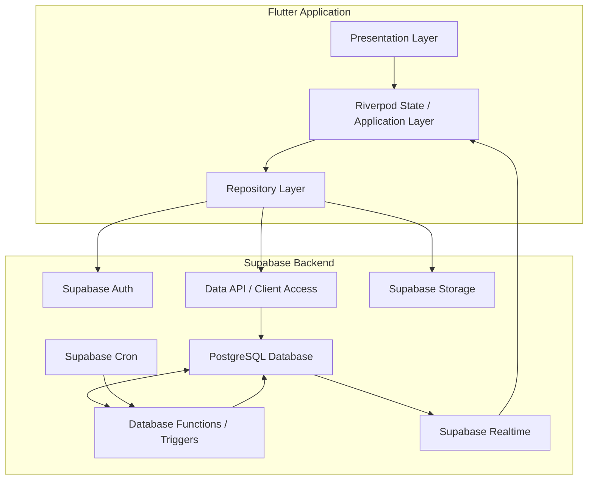
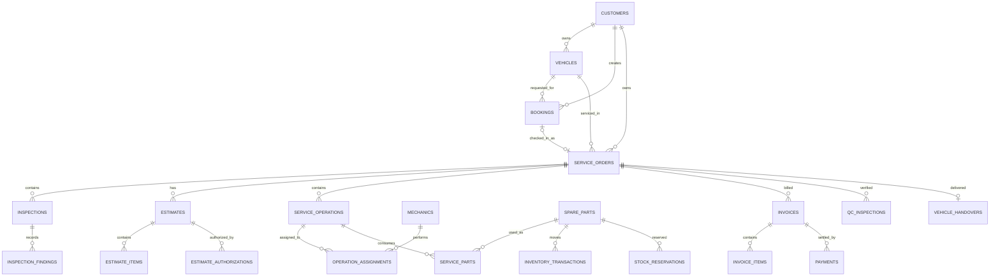

# Architecture — PitMate

> **Status:** Approved — 2026-11-20  
> **Version:** 2.0  
> **Last updated:** 2026-11-20  
> **Project type:** Clean-slate Flutter application  
> **Related:** PRD.md, DESIGN.md, MILESTONE.md

---

# 1. Read This First

## Architecture in one paragraph

PitMate uses a single Flutter application connected directly to a Supabase backend. Flutter handles presentation, navigation, local interaction state and user workflows. Supabase provides authentication, PostgreSQL persistence, Row Level Security, Realtime synchronization, database functions and scheduled processing. The application uses a feature-first architecture with clear presentation, application/state and data boundaries. Complex business transactions are enforced on the backend, while ordinary CRUD operations use the Supabase client through repositories.

## Selected stack

- Flutter and Dart.
- Supabase.
- PostgreSQL.
- Supabase Auth.
- Supabase Realtime.
- Supabase Storage where attachments are required.
- Riverpod.
- GoRouter.
- Git and GitHub.

## Main components

1. Flutter presentation layer.
2. Flutter application/state layer.
3. Flutter repository/data layer.
4. Supabase Auth.
5. Supabase PostgreSQL.
6. PostgreSQL functions and triggers.
7. Supabase Realtime.
8. Supabase Cron.
9. Supabase Storage.

## Current technical risks

- Correctly enforcing business workflow transitions.
- Inventory consistency under concurrent operations.
- Correct financial calculations and historical snapshots.
- RLS policies across three roles and guest customers.
- Reliable event-driven notifications.
- Synchronization across desktop and mobile clients.
- Correct handling of supplementary repair authorization.

## Current implementation status

Approved. Milestone M1 — Application Foundation complete with multi-role authentication, responsive shells, customer and vehicle registry, and 197 passing automated tests.

## Next technical action

Proceed with Milestone M2 — Customer Intake & Diagnosis (Booking Management, Walk-in Admission, Workshop Queue, and Vehicle Inspection).

---

# 2. Technology Stack

| Layer | Technology | Purpose | Status |
|---|---|---|---|
| Application framework | Flutter | Cross-platform UI | Approved |
| Language | Dart | Application development | Approved |
| Backend platform | Supabase | Managed backend infrastructure | Approved |
| Database | PostgreSQL | Relational persistence | Approved |
| Authentication | Supabase Auth | Account authentication | Approved |
| Authorization | PostgreSQL RLS | Row-level access control | Approved |
| Realtime | Supabase Realtime | Live synchronization | Approved |
| File storage | Supabase Storage | Inspection photos and attachments | Recommended |
| State management | Riverpod | Application state | Recommended |
| Navigation | GoRouter | Role-based routing | Recommended |
| Database logic | PostgreSQL functions | Transactional operations | Recommended |
| Scheduled processing | Supabase Cron | Reminder scheduling | Recommended |
| Server-side functions | Supabase Edge Functions | Optional external/server-side operations | Conditional |
| Version control | Git/GitHub | Source control and collaboration | Recommended |
| Testing | Flutter Test + Supabase integration tests | Verification | Recommended |

## 2.1 Dependency policy

Do not select arbitrary dependency versions.

At project initialization:

1. Check the installed Flutter and Dart versions.
2. Check current package compatibility.
3. Select stable compatible dependencies.
4. Pin dependencies through the project's package constraints.
5. Commit `pubspec.lock`.
6. Record important version choices in project documentation.

Do not upgrade major dependencies casually during feature implementation.

## 2.2 Why this stack?

Flutter is mandatory for the university project.

Supabase is sufficient for backend requirements without introducing a separately maintained backend application.

PostgreSQL provides relational integrity and transactional operations.

Riverpod and GoRouter are recommended because they provide predictable state management and navigation without introducing a complex application framework.

No microservices, separate Node.js backend, Redis, Kubernetes or dedicated message broker are required.

---

# 3. System Architecture

## 3.1 High-level architecture



## 3.2 Flutter presentation layer

Responsibilities:

- Render responsive interfaces.
- Display data.
- Collect user input.
- Show loading, empty, success and error states.
- Present role-specific navigation.
- Trigger application actions.

The presentation layer must not contain database queries or complex financial calculations.

## 3.3 Application/state layer

Responsibilities:

- Manage feature state.
- Coordinate user actions.
- Apply presentation-level validation.
- Call repositories.
- Observe realtime changes.
- Handle asynchronous loading and error states.

Riverpod is the recommended state management solution.

Use feature-specific providers rather than a single global provider containing unrelated business state.

## 3.4 Repository/data layer

Responsibilities:

- Read and write application data.
- Convert database responses into domain models.
- Handle Supabase exceptions.
- Expose consistent repository contracts.
- Invoke PostgreSQL functions where required.
- Keep database implementation details away from UI widgets.

Repositories should be organized by business feature.

## 3.5 Supabase backend

### PostgreSQL

Stores all persistent business data.

### Supabase Auth

Manages authenticated users and sessions.

### Row Level Security

Restricts access to records based on authenticated identity, role and ownership.

### Database functions

Handle atomic multi-record business operations.

Examples:

- Check in booking.
- Admit walk-in.
- Approve estimate.
- Reserve inventory.
- Issue parts.
- Consume parts.
- Complete service operation.
- Record payment.
- Close service order.
- Allocate mechanic incentives.

### Database triggers

Handle database-level side effects where appropriate.

Examples:

- Record status history.
- Generate audit events.
- Create notification records.
- Maintain derived inventory balances when required.

### Supabase Realtime

Synchronizes connected clients with relevant database changes.

### Supabase Cron

Executes scheduled operations such as maintenance reminder processing.

### Supabase Storage

Stores inspection photos and other permitted attachments.

---

# 4. Main Data and Request Flows

## 4.1 Authentication

1. User opens the Flutter application.
2. User authenticates through Supabase Auth.
3. Supabase validates credentials.
4. Flutter receives the authenticated session.
5. Application retrieves the corresponding profile.
6. Role and permissions determine accessible navigation.
7. Unauthorized access is rejected by both routing and backend authorization.

Public customer registration must never permit self-assignment of admin or mechanic roles.

## 4.2 Guest customer intake

1. Admin opens customer intake.
2. Admin chooses guest customer.
3. Customer information is entered.
4. Vehicle information is entered.
5. Service complaint is recorded.
6. Flutter invokes the authorized intake operation.
7. PostgreSQL creates the customer/guest record and vehicle relationship.
8. A service order is created.
9. The transaction commits.
10. Relevant operational events and notifications are generated.

Guest customers do not need Supabase Auth accounts.

## 4.3 Booking and check-in

1. Customer submits a booking.
2. Booking is stored in PostgreSQL.
3. Admin reviews the booking.
4. Admin approves, rejects or reschedules.
5. Customer receives a notification.
6. Customer arrives.
7. Admin performs check-in.
8. Backend validates the booking.
9. A service order is created.
10. Booking becomes checked in.

Booking approval must not automatically create physical workshop occupancy.

## 4.4 Inspection and estimate

1. Service order enters inspection stage.
2. Mechanic receives inspection assignment.
3. Mechanic records findings.
4. Findings are saved with associated evidence.
5. Inspection is submitted.
6. Admin reviews findings.
7. Admin builds an estimate.
8. Backend calculates applicable charges using configured pricing rules.
9. Estimate is issued to customer.
10. Customer approves, rejects or requests clarification.
11. Authorization history is preserved.

## 4.5 Service dispatch and execution

1. Admin reviews authorized operations.
2. Admin checks mechanic availability.
3. Admin assigns mechanics.
4. Admin allocates bay and required stock.
5. Mechanic receives assignment notification.
6. Mechanic starts operation.
7. Mechanic updates checklist and progress.
8. Backend validates operation dependencies.
9. Completion is recorded.
10. QC eligibility is updated.

Multiple operations can run concurrently when their dependencies permit.

## 4.6 Inventory allocation

1. Admin receives or adjusts stock.
2. Backend records an inventory movement.
3. Available quantity is updated.
4. Admin reserves parts for an approved operation.
5. Mechanic requests required parts if necessary.
6. Admin fulfills the request.
7. Parts are issued to the operation.
8. Mechanic records actual consumption.
9. Unused parts are returned.
10. Inventory cost is assigned to the service operation.

Every stock mutation must be transactional.

## 4.7 Additional repair findings

1. Mechanic reports additional finding.
2. Backend records finding and event.
3. Admin receives notification.
4. Admin creates supplementary estimate.
5. Customer receives approval request.
6. Customer decision is recorded.
7. Original independent operations continue.
8. Newly approved operations become eligible for dispatch.
9. Rejected or deferred work remains in history.

An unsafe affected operation can be paused independently of unrelated work.

## 4.8 Completion and payment

1. Required operations are completed.
2. QC is performed.
3. Failed QC returns affected work for correction.
4. Passed QC permits final billing.
5. Invoice is generated from authorized completed work.
6. Deposits are reconciled.
7. Customer or admin records payment.
8. Cash change is calculated when applicable.
9. Payment record is persisted.
10. Receipt is generated.
11. Handover is recorded.
12. Service order is closed.
13. Customer history and reminders are updated.

---

# 5. Project Structure

The following is the intended structure, not an existing verified repository.

```text
pitmate/
│
├── android/
├── web/
│
├── lib/
│   ├── main.dart
│   │
│   ├── app/
│   │   ├── app.dart
│   │   ├── bootstrap.dart
│   │   ├── router/
│   │   │   ├── app_router.dart
│   │   │   ├── route_paths.dart
│   │   │   └── route_guards.dart
│   │   ├── theme/
│   │   │   ├── app_theme.dart
│   │   │   ├── app_colors.dart
│   │   │   ├── app_typography.dart
│   │   │   └── app_spacing.dart
│   │   └── config/
│   │       └── app_config.dart
│   │
│   ├── core/
│   │   ├── errors/
│   │   ├── extensions/
│   │   ├── utils/
│   │   ├── constants/
│   │   ├── services/
│   │   └── widgets/
│   │
│   ├── shared/
│   │   ├── models/
│   │   ├── widgets/
│   │   ├── providers/
│   │   └── layouts/
│   │
│   ├── features/
│   │   ├── auth/
│   │   ├── customers/
│   │   ├── vehicles/
│   │   ├── bookings/
│   │   ├── workshop/
│   │   ├── inspections/
│   │   ├── estimates/
│   │   ├── service_orders/
│   │   ├── operations/
│   │   ├── mechanics/
│   │   ├── inventory/
│   │   ├── quality_control/
│   │   ├── finance/
│   │   ├── notifications/
│   │   ├── reminders/
│   │   └── reports/
│   │
│   └── localization/
│
├── supabase/
│   ├── config.toml
│   ├── migrations/
│   ├── functions/
│   └── seed.sql
│
├── test/
│   ├── unit/
│   ├── widget/
│   ├── integration/
│   └── fixtures/
│
├── integration_test/
│
├── docs/
│   ├── PRD.md
│   ├── DESIGN.md
│   ├── ARCHITECTURE.md
│   ├── MILESTONE.md
│   ├── DATABASE_SCHEMA.md
│   ├── BUSINESS_FLOWS.md
│   ├── TESTING.md
│   ├── SEED_STRATEGY.md
│   ├── DECISIONS.md
│   └── CHANGELOG.md
│
├── AGENTS.md
├── README.md
├── pubspec.yaml
├── pubspec.lock
└── .gitignore
```

## 5.1 Feature organization

Each feature should own its presentation, state and data responsibilities.

Example:

```text
features/
└── inventory/
    ├── data/
    │   ├── models/
    │   ├── datasources/
    │   └── repositories/
    │
    ├── application/
    │   ├── providers/
    │   └── controllers/
    │
    └── presentation/
        ├── pages/
        ├── widgets/
        └── dialogs/
```

Do not create empty folders for every theoretical architectural pattern.

Only introduce additional abstraction when the feature needs it.

## 5.2 Dependency direction

```text
Presentation
     ↓
Application / State
     ↓
Repository Contracts
     ↓
Data Implementation
     ↓
Supabase
```

A widget must not directly execute complex SQL or business workflows.

---

# 6. Data Model

## 6.1 Database design principles

1. PostgreSQL is the source of truth.
2. All business records use stable identifiers.
3. Relationships use foreign keys.
4. Important quantities and monetary values use appropriate numeric types.
5. Timestamps are stored consistently in UTC.
6. Displayed dates are converted to the user's local timezone.
7. Financial records preserve historical snapshots.
8. Important state changes are recorded.
9. Inventory movements are auditable.
10. Destructive deletion is restricted for historical records.

## 6.2 Identity domain

Candidate tables:

| Table | Responsibility |
|---|---|
| profiles | Authenticated user profiles and roles |
| customers | Customer-specific business information |
| mechanics | Technician information |
| mechanic_skills | Technician capabilities |
| workshop_settings | Workshop configuration |

Guest customers are represented in customer records without requiring an authenticated profile.

Account linking must be explicit and verified.

## 6.3 Fleet domain

| Table | Responsibility |
|---|---|
| vehicles | Vehicle registry |
| vehicle_documents | Optional vehicle documents |
| vehicle_maintenance_records | Historical maintenance information |

A customer may own multiple vehicles.

Each service order must reference a specific vehicle and customer.

## 6.4 Booking domain

| Table | Responsibility |
|---|---|
| bookings | Appointment requests |
| booking_history | Booking status changes |
| appointment_slots | Optional configurable appointment capacity |

Bookings are not physical service orders until check-in.

## 6.5 Workshop domain

| Table | Responsibility |
|---|---|
| service_orders | Main vehicle visit record |
| service_order_history | Service order status history |
| workshop_bays | Five configurable physical bays |
| bay_assignments | Vehicle-to-bay allocation history |
| inspections | Inspection sessions |
| inspection_findings | Individual findings |
| inspection_attachments | Related evidence |

A service order is the central record connecting the entire vehicle visit.

## 6.6 Estimate domain

| Table | Responsibility |
|---|---|
| estimates | Estimate revisions |
| estimate_items | Proposed service and parts lines |
| estimate_authorizations | Customer approval/rejection decisions |
| estimate_history | Estimate changes |

Original estimates and their revisions must remain historically accessible.

## 6.7 Service execution domain

| Table | Responsibility |
|---|---|
| service_operations | Individual work operations |
| operation_dependencies | Sequential/parallel dependencies |
| operation_assignments | Mechanic participation |
| operation_checklists | Checklist definitions |
| operation_checklist_items | Individual checklist items |
| operation_progress_history | Operation status history |
| additional_findings | Newly discovered issues |

A service order contains multiple operations.

An operation can have multiple mechanic assignments.

## 6.8 Inventory domain

| Table | Responsibility |
|---|---|
| spare_parts | Part catalog |
| inventory_balances | Maintained stock quantities |
| inventory_transactions | Immutable stock movement ledger |
| stock_reservations | Quantities allocated to jobs |
| part_requests | Mechanic requests |
| service_parts | Actual parts consumed by operations |

The movement ledger is the authoritative audit record.

`inventory_balances` is a maintained operational balance and must reconcile with the movement ledger.

## 6.9 Finance domain

| Table | Responsibility |
|---|---|
| service_catalog | Configurable services |
| service_pricing | Historical pricing configuration |
| tax_configurations | Tax rules |
| insurance_records | Customer coverage information |
| estimates | Proposed charges |
| invoices | Final payable documents |
| invoice_items | Historical billing lines |
| payments | Recorded payment events |
| refunds | Authorized refund records |
| financial_adjustments | Corrections and adjustments |

Use fixed-precision numeric values for money. Do not use floating-point values for financial calculations.

Use integer currency minor units where appropriate, with an explicit currency configuration.

## 6.10 Workforce domain

| Table | Responsibility |
|---|---|
| mechanic_compensation_rules | Base salary and incentive rules |
| mechanic_earnings | Earned incentives |
| mechanic_earning_allocations | Contribution split |
| payroll_periods | Monthly calculation periods |
| payroll_adjustments | Approved corrections |

Base salary and service incentives must remain separate.

## 6.11 Quality and handover domain

| Table | Responsibility |
|---|---|
| qc_inspections | QC sessions |
| qc_checklist_items | QC results |
| vehicle_handovers | Physical vehicle delivery records |

Vehicle completion, invoice settlement and handover are separate events.

## 6.12 Communication domain

| Table | Responsibility |
|---|---|
| notifications | Persistent user notifications |
| notification_events | Event delivery/idempotency tracking |
| notification_preferences | User preferences |
| service_reminders | Maintenance reminders |
| audit_logs | Important system actions |

## 6.13 Relationship overview



This is a conceptual relationship diagram, not the final SQL schema.

The final database design must specify unique constraints, nullable relationships, indexes, delete behavior, foreign keys and RLS policies.

## 6.14 Database migration strategy

Use version-controlled Supabase migrations.

Rules:

1. Every schema change must have a migration.
2. Migration filenames must be generated using the installed Supabase CLI.
3. Migrations must be ordered and reproducible.
4. No manual production schema changes without corresponding migration documentation.
5. Test migrations against a clean local database.
6. Verify RLS and database functions after migration.
7. Keep seed data separate from schema migrations where practical.

The new database must not inherit the old schema.

### Database reset policy

Preferred approach: create a separate Supabase project for the redesigned PitMate.

If the existing Supabase project is explicitly selected for reuse:

- Verify its project identity.
- Back up necessary data.
- Confirm the environment is development.
- Obtain explicit approval for destructive reset.
- Apply the new migration history only after verification.

Never reset an unknown or production database.

---

# 7. API and Integration Contracts

The application uses the Supabase client for ordinary data operations and database RPC for critical transactional workflows.

## 7.1 Direct repository operations

Suitable for:

- Reading service catalog entries.
- Reading customer vehicles.
- Loading notifications.
- Reading service history.
- Updating permitted profile fields.
- Loading inventory lists.

These operations still require correct RLS policies.

## 7.2 Transactional database operations

Use PostgreSQL functions for operations involving multiple related records or critical invariants.

Candidate operations:

| Operation | Responsibility |
|---|---|
| create_guest_intake | Create guest customer, vehicle and service order |
| check_in_booking | Convert approved booking into service order |
| submit_inspection | Validate and submit inspection |
| create_estimate_revision | Create estimate revision and items |
| record_customer_authorization | Record customer decision |
| assign_service_operation | Assign mechanics and validate availability |
| reserve_inventory | Reserve available stock |
| fulfill_part_request | Allocate requested stock |
| consume_service_parts | Record actual part consumption |
| return_unused_parts | Return unused stock |
| complete_operation | Validate and complete operation |
| submit_for_qc | Submit eligible work for QC |
| record_qc_result | Pass or fail quality inspection |
| finalize_invoice | Create final invoice snapshot |
| record_payment | Record payment and reconcile balance |
| record_vehicle_handover | Record physical delivery |
| allocate_mechanic_incentive | Calculate approved operation contribution |

These are proposed logical operation names. Exact SQL signatures will be defined during database implementation.

## 7.3 Error contract

Operations should return predictable success/error results.

Error categories:

- Validation error.
- Authorization error.
- Not found.
- Conflict.
- Invalid state transition.
- Insufficient stock.
- Insufficient payment.
- Dependency not satisfied.
- Internal failure.

The UI should display understandable messages rather than raw database errors.

## 7.4 Retry and idempotency

Critical operations should support safe retries.

Examples:

- Payment recording.
- Booking check-in.
- Stock consumption.
- Notification creation.
- Service completion.

Use unique operation references or idempotency keys where duplicate execution could cause financial or inventory inconsistencies.

---

# 8. Security and Privacy

## 8.1 Authentication

- Supabase Auth manages authenticated accounts.
- Profiles reference Auth user IDs.
- Roles are controlled by authorized administration.
- Guest customer records are not authenticated users.

## 8.2 Authorization

Roles:

- Admin.
- Mechanic.
- Customer.

Authorization must be enforced by PostgreSQL RLS and validated backend functions.

Client-side navigation restrictions are not security boundaries.

## 8.3 Customer access

Customers may access:

- Their own profile.
- Their own vehicles.
- Their bookings.
- Their service orders.
- Their approved customer-facing inspection information.
- Their estimates and decisions.
- Their invoices and payments.
- Their notifications and reminders.

Customers must not access:

- Other customers' information.
- Internal workshop notes.
- Mechanic salary information.
- Internal purchase costs.
- Other users' assignments.
- Administrative settings.

Guest records are accessible only to authorized workshop personnel until securely linked to a verified customer account.

## 8.4 Mechanic access

Mechanics may access:

- Their assigned service orders.
- Relevant vehicle information.
- Approved operation instructions.
- Assigned checklists.
- Required part information.
- Their own earnings.
- Their notifications.

Mechanics cannot independently modify invoice totals, stock balances, customer ownership or compensation rules.

## 8.5 Admin access

Admin has operational access subject to explicit business permissions.

Financial configuration, refunds, salary changes and stock adjustments must be auditable.

## 8.6 Supabase security rules

- Enable RLS on every exposed application table.
- Define policies per actual access requirement.
- Do not rely on authentication alone for record ownership.
- Never place service-role or secret keys in Flutter.
- Use publishable client credentials.
- Keep privileged operations inside trusted backend contexts.
- Avoid SECURITY DEFINER functions unless a specific security-reviewed requirement justifies them.
- Restrict function execution permissions.
- Validate all input at the backend.
- Protect Storage objects with appropriate policies.

Official security guidance: https://supabase.com/docs/guides/security

## 8.7 Sensitive information

Mechanic compensation, customer contact information, insurance references and financial records require appropriate access restrictions.

Do not log passwords, authentication tokens or unnecessary personal data.

---

# 9. Development Environment

## 9.1 Runtime

- Flutter stable channel.
- Compatible Dart SDK.
- Supabase project.
- Supabase CLI.
- Git.
- Antigravity IDE.

Exact versions are pending project initialization and compatibility checks.

## 9.2 Package manager

Use Flutter's Dart package workflow.

Dependencies are declared in `pubspec.yaml`.

Lockfile is committed.

## 9.3 Initial setup

Planned commands, to be verified against the installed toolchain:

```bash
flutter --version
dart --version

flutter create pitmate

cd pitmate

flutter pub add supabase_flutter
flutter pub add flutter_riverpod
flutter pub add go_router

flutter pub get
```

The additional packages are recommendations, not proof that they have been installed.

## 9.4 Supabase setup

Use the official Supabase Flutter quickstart:

https://supabase.com/docs/guides/getting-started/quickstarts/flutter

The Supabase project should be created separately for the redesigned application.

The development environment should use the Supabase CLI and a local Supabase stack where practical for migration and database testing.

## 9.5 Commands

| Purpose | Command | Status |
|---|---|---|
| Flutter version | `flutter --version` | Not verified |
| Dart version | `dart --version` | Not verified |
| Install dependencies | `flutter pub get` | Not verified |
| Run Android | `flutter run -d <device>` | Not verified |
| Run web | `flutter run -d chrome` | Not verified |
| Analyze | `flutter analyze` | Not verified |
| Format | `dart format .` | Not verified |
| Unit/widget tests | `flutter test` | Not verified |
| Integration tests | `flutter test integration_test` | Not verified |
| Build Android | `flutter build apk` | Not verified |
| Build web | `flutter build web` | Not verified |

Discover installed Supabase CLI commands through its help output before relying on specific flags.

## 9.6 Development environment configuration

Separate:

- Local development.
- Shared testing/staging.
- Production, if eventually deployed.

Never commit real secrets.

Use build-time configuration for the Flutter client.

Publishable credentials are not equivalent to privileged server secrets.

---

# 10. Testing Strategy

Testing is organized around actual business workflows.

## Unit tests

Test:

- Money calculations.
- Tax calculations.
- Cash change.
- Insurance coverage allocation.
- Weighted-average inventory costing.
- Mechanic incentive splitting.
- Service operation dependency rules.
- State transitions.
- Model serialization.

## Widget tests

Test:

- Responsive scaffolds.
- Admin navigation.
- Mechanic task workspace.
- Customer service tracking.
- Forms and validation.
- Dialogs and bottom sheets.
- Loading and error states.

## Integration tests

Test complete Supabase interactions:

- Authentication and role access.
- Guest intake.
- Booking check-in.
- Inspection submission.
- Estimate authorization.
- Stock reservation.
- Part consumption.
- Payment recording.
- Notification persistence.

## End-to-end tests

Important complete scenarios:

1. Guest walk-in through vehicle handover.
2. Registered customer booking through payment.
3. Multiple mechanics sharing a service order.
4. Missing part blocking an operation.
5. Supplementary work rejection without blocking original work.
6. Failed QC followed by successful repair.
7. Cash payment and change.
8. Simulated external payment.
9. Customer notification synchronization.

## Regression testing

Every significant change must run:

- Relevant unit tests.
- Relevant widget tests.
- Relevant integration tests.
- Affected workflow regression tests.
- `flutter analyze`.

A successful compilation alone is not acceptance evidence.

---

# 11. Git and Collaboration

## 11.1 Branch naming

```text
main
develop

feature/PM-001-authentication
feature/PM-002-customer-intake

fix/PM-015-stock-reservation
refactor/PM-021-workshop-layout

docs/PM-030-database-design
test/PM-040-service-lifecycle
```

## 11.2 Pull request process

1. Create branch from the agreed integration branch.
2. Implement one bounded task.
3. Run relevant tests.
4. Inspect complete Git diff.
5. Update documentation if required.
6. Open pull request.
7. Review affected workflows.
8. Merge only after verification.

## 11.3 Agent collaboration

Antigravity agents may work on independent tasks when dependencies are clear.

Rules:

- One owner per shared file during parallel work.
- No concurrent migrations without coordination.
- No simultaneous edits to shared business models without agreement.
- Shared interfaces must be agreed before parallel implementation.
- Every agent must report files changed and tests executed.
- Agents must not merge their own unreviewed changes automatically.

## 11.4 Git rules

- No direct unreviewed work on `main`.
- No force push to shared branches.
- No committing credentials.
- No committing generated temporary files unnecessarily.
- No deleting tests to make validation pass.
- No unrelated formatting or refactoring in focused bug-fix changes.

---

# 12. CI/CD and Deployment

## Initial development

- Local Flutter development.
- Local Supabase testing where practical.
- Android emulator/physical device testing.
- Flutter Web for desktop admin testing.

## Continuous integration

Recommended checks:

1. Dependency resolution.
2. Formatting verification.
3. Static analysis.
4. Unit tests.
5. Widget tests.
6. Relevant integration tests.
7. Web build.
8. Android build.

## Deployment

No automatic deployment is authorized yet.

Potential future targets:

- Android APK for university demonstration.
- Hosted Flutter Web for remote admin access.
- Supabase hosted backend.

## Rollback

- Git revert for application changes.
- Database backup before destructive changes.
- Forward-fix or reviewed migration rollback strategy.
- Restore from backup only after environment and data impact review.

---

# 13. Technical Decisions

| ID | Decision | Status | Reason | Impact |
|---|---|---|---|---|
| TD-001 | Flutter | Approved | University requirement | Client |
| TD-002 | Supabase | Approved | Sufficient managed backend | Backend |
| TD-003 | PostgreSQL | Approved | Relational integrity | Database |
| TD-004 | Riverpod | Recommended | Maintainable state management | Flutter |
| TD-005 | GoRouter | Recommended | Central navigation | Flutter |
| TD-006 | Feature-first structure | Recommended | Feature isolation | Codebase |
| TD-007 | Repository pattern | Recommended | Data access separation | Data layer |
| TD-008 | PostgreSQL functions for critical operations | Recommended | Atomic transactions | Backend |
| TD-009 | Supabase Realtime | Approved | Live updates | All roles |
| TD-010 | Supabase Cron | Recommended | Scheduled reminders | Backend |
| TD-011 | New database schema | Approved | Clean-slate redesign | Database |
| TD-012 | New Supabase project | Recommended | Safest separation | Infrastructure |
| TD-013 | No separate backend server | Approved | Avoid unnecessary complexity | Infrastructure |
| TD-014 | No real payment gateway | Approved | Simulated payment scope | Finance |
| TD-015 | New migration history | Approved | Reproducible database | Database |

---

# 14. Risks and Validation

| Risk | Impact | Smallest validation | Status |
|---|---|---|---|
| RLS complexity | High | Three-role access PoC | Pending |
| Guest account linking | High | Guest-to-account linking PoC | Pending |
| Inventory concurrency | High | Concurrent stock reservation test | Pending |
| Estimate revisions | High | Authorization lifecycle test | Pending |
| Multiple mechanic assignments | Medium | Assignment model test | Pending |
| Realtime updates | High | Two-client synchronization PoC | Pending |
| Scheduled reminders | Medium | Scheduled job PoC | Pending |
| Financial calculations | High | Calculation unit tests | Pending |
| Image uploads | Medium | Storage policy PoC | Pending |
| Responsive admin UI | Medium | Desktop/mobile layout prototype | Pending |
| Migration reproducibility | High | Clean database migration test | Pending |

## Required early technical spikes

### SPIKE-001 — Role and RLS foundation

Verify:
- Admin access.
- Mechanic assigned-job access.
- Customer ownership restrictions.
- Guest records inaccessible to public clients.

### SPIKE-002 — Realtime synchronization

Run:
- Two browser sessions.
- One Android session.
- One admin session.
- One mechanic session.

Verify that a service status update is reflected without manually refreshing the other connected clients.

### SPIKE-003 — Inventory transaction integrity

Test two concurrent requests attempting to reserve the same limited stock.

Verify that the total reserved quantity cannot exceed available stock.

### SPIKE-004 — Notification scheduling

Verify:
- Database event creates notification.
- Connected user sees it immediately.
- Scheduled reminder is generated once.
- Duplicate processing does not generate duplicate notifications.

### SPIKE-005 — Financial consistency

Verify:
- Tax calculation.
- Deposit deduction.
- Cash change.
- Partial payment.
- Invoice reconciliation.
- Mechanic incentive allocation.

Do not build the dependent production features until their relevant high-risk assumptions are validated.

---

# 15. Change Rules

## PRD changes

Update when:
- Business rules change.
- A feature is added or removed.
- Acceptance criteria change.
- Role responsibilities change.

## DESIGN changes

Update when:
- Navigation changes.
- A screen's behavior changes.
- New shared components are introduced.
- Responsive behavior changes.

## ARCHITECTURE changes

Update when:
- Data ownership changes.
- Database structure changes materially.
- Backend responsibilities change.
- New dependencies are introduced.
- Security boundaries change.

## MILESTONE changes

Update when:
- Milestone order changes.
- A vertical slice is completed or deferred.
- A major blocker appears.
- Next priorities change.

## Database change rules

- Every committed schema change requires a migration.
- Every critical business operation requires appropriate verification.
- No unreviewed destructive migrations.
- No silent changes to financial or inventory logic.

## Agent implementation rules

- Discovery before modification.
- Change request before substantial refactoring.
- Implementation plan before coding.
- Tests defined before implementation.
- Focused changes.
- Full diff review.
- Documentation synchronization after verification.

---

# 16. References

Official Supabase documentation:

- Flutter integration: https://supabase.com/docs/reference/dart/introduction
- Flutter quickstart: https://supabase.com/docs/guides/getting-started/quickstarts/flutter
- Authentication: https://supabase.com/docs/guides/auth
- Database: https://supabase.com/docs/guides/database/overview
- Database functions: https://supabase.com/docs/guides/database/functions
- Realtime: https://supabase.com/docs/guides/realtime
- Edge Functions: https://supabase.com/docs/guides/functions
- Security: https://supabase.com/docs/guides/security

---

# Architecture Handoff

Architecture status: Proposed.

The architecture is intentionally limited to Flutter and Supabase.

The final SQL schema, exact package versions, RPC signatures, RLS policies and deployment configuration must be established and verified during implementation planning.

No code or database changes are authorized by this document alone.
