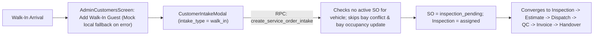
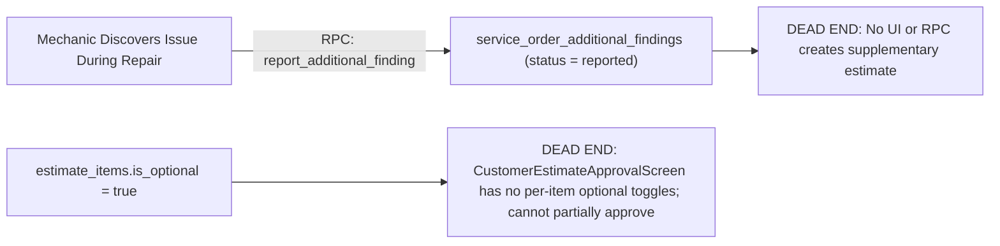
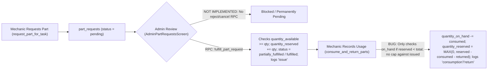
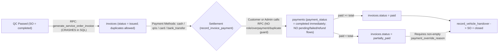

# PitMate — Post-M7 Functional Validation & Requirements Audit Report

> **Audit Date:** 2026-11-25  
> **Scope:** Inspection-only audit of PitMate post-Milestone M7 (`HEAD` `6a0a5d8`)  
> **Sources Audited:** Flutter client (`lib/`), Supabase SQL migrations (`supabase/migrations/*.sql`, `supabase/seed.sql`), configuration (`supabase/config.toml`, `lib/config/app_config.dart`), automated tests (`test/`, `test_e2e/m7_playwright_test.js`), and canonical docs (`docs/`)  
> **Executed Verification:** `flutter analyze` (`No issues found!`, 8.6s) and `flutter test` (`216` tests passed in 58s; note mock/fallback composition analyzed in Part 13)  
> **Live Database Execution Note:** No live SQL queries or authenticated Playwright E2E sessions were executed against the remote Supabase instance in this inspection-only audit; PostgreSQL runtime failures reported below are proven directly from static SQL DDL vs RPC body inspection.

---

# PART 14 — FINAL INTERVIEW REPORT (OVERVIEW FIRST)

## A. Executive Summary

- **Overall Implementation Status:** **NOT PRODUCTION / DEMO-COMPLETE (FAIL on Core End-to-End Integration).** While `flutter analyze` reports `0` issues and `flutter test` reports `216/216` passing, PitMate exhibits severe runtime disconnects between documentation claims (`docs/HANDOFF_M7.md` "Zero Mock Policy"), UI screens, Flutter repositories, and PostgreSQL RPCs. Several core database RPCs cannot execute at all due to referencing nonexistent columns and enum values.
- **Most Important Missing Functionality:**
  1. **Broken Core SQL RPCs:** `generate_service_order_invoice` references nonexistent `service_order_tasks.task_name` and `standard_hours`; `get_workshop_daily_metrics` and `get_workshop_monthly_metrics` reference nonexistent `service_orders.completed_at`, `service_orders.bay_id`, and enum `'inspection'`; `get_customer_service_tracking` references nonexistent enums (`'draft'`, `'confirmed'`, `'intake'`, `'inspection'`, `'ready_for_handover'`) and columns (`t.task_name`, `f.description`).
  2. **Hardcoded / Demo-Only Primary Screens:** `AdminOverviewScreen` and `MechanicHomeScreen` display static demo data; `OperationWorkspaceScreen` and `MechanicEarningsScreen` hardcode a single mechanic UUID (`7294334d-7144-4c14-9d28-5f90e48a5fbb`); `DispatchOperationsModal` hardcodes 2 brake tasks and 2 mechanic UUIDs; `AdminEstimateBuilderScreen` initializes hardcoded brake findings and never loads real inspection findings from DB; `AdminInspectionReviewScreen` "Create Estimate" button opens an informational dialog instead of navigating to `/admin/estimates`.
  3. **Missing Supplementary / Optional Work Partial Approval:** `CustomerEstimateApprovalScreen` only provides global Approve/Reject buttons despite schema support for `estimate_items.is_optional` and `estimate_status.partially_approved`, and there is no workflow converting `service_order_additional_findings` into supplementary customer estimates.
  4. **Unwired Notifications & Reminders:** Neither database triggers nor application repositories invoke `create_notification_event` or `generate_service_order_reminders` across any lifecycle transition.
- **Most Serious Business Logic & Financial Risks:**
  1. **100x Rupiah vs Cents Mismatch in Mechanic Compensation:** Seeded salaries use cents (`850000000` = Rp 8.5M × 100), while `AdminMechanicEarningsScreen` and `MechanicEarningsScreen` label inputs/outputs `(Rp)` and format raw integers without `/ 100` or `* 100` (displaying Rp 850.000.000).
  2. **Broken & Non-Transactional Mechanic Incentive Pipeline:** `complete_task_operation` never calls `generate_task_mechanic_incentives`; `MechanicCompensationRepository.generateTaskIncentives` passes 6 mismatched parameters; `generate_task_mechanic_incentives` ignores `standard_incentive_percent` (hardcodes 15%) and allocates 35% *per helper* rather than splitting 35% across helpers (exceeding 100% if ≥2 helpers).
  3. **Tax Calculation Inconsistency:** `EstimateModel.calculateTax` applies 11% *before* discount with `.round()`, whereas `InvoiceModel.calculateTaxableSubtotal` + `generate_service_order_invoice` apply 11% *after* discount using truncating integer math (`~/ 100` / SQL integer division).
  4. **Invoicing Ignores Estimates & Task Completion:** `generate_service_order_invoice` bills `service_order_tasks` (ignoring `estimate_items`, task `status`, and `qc_status = 'passed'`), allows duplicate invoices per service order, and `record_invoice_payment` does not prevent overpayment (`amount > outstanding`).
  5. **Bay Occupancy Desync & Silent Swallowing:** `create_service_order_intake` neither checks `workshop_bays` availability nor marks the bay `occupied`; `record_vehicle_handover` closes the order without releasing the bay; multiple UI screens catch Supabase errors and silently fall back to fake local state or success messages.
- **Most Serious Security Risks:**
  1. **Privilege Escalation at Signup (`P0`):** `public.handle_new_user()` (`20261122000000_m1_auth_profiles.sql` L58) reads `NEW.raw_user_meta_data->>'role'` directly instead of forcing `'customer'`, violating `docs/DATABASE_SCHEMA.md` L181.
  2. **Unprotected `SECURITY DEFINER` RPCs (`P0`):** Almost all M2–M6 RPCs (`create_service_order_intake`, `submit_inspection`, all 8 M3 operational RPCs, all 7 M4 inventory/compensation RPCs, all 6 M5 QC/invoice/payment/handover RPCs, all 6 M6 notification/reminder/report RPCs) lack role or ownership enforcement, and M5/M6 `SECURITY DEFINER` functions omit `SET search_path = public`.
  3. **Client-Side Router & RLS Gaps (`P0`/`P1`):** `app_router.dart` performs zero auth or role checks on `/admin/*`, `/mechanic/*`, `/customer/*`; `public.notifications` INSERT RLS uses `WITH CHECK (true)` for all authenticated users; `public.workshop_bays` SELECT RLS allows anonymous reads (`USING (true)` without `TO authenticated`); mechanic RLS grants workshop-wide access to unassigned orders, tasks, customers, and vehicles.
- **Most Important Unresolved Business Decisions:** Tax configuration ownership and discount-before-vs-after-tax basis; exact mechanic compensation formula, percentage scope, and multi-mechanic split method; weighted-average costing approval; stock reservation/deduction timing; formal replenishment/PO tracking; refund/reversal policy; partial payment & deposit rules; bay scheduling/reservation rules; supplementary estimate remote vs admin-assisted approval.

---

## B. Requirements Traceability Matrix

| ID | Requirement | Original Decision | Current Implementation | Status | Evidence | Missing Work |
|---|---|---|---|---|---|---|
| REQ-01 | Single-workshop 3-role architecture | Single workshop; Admin, Mechanic, Customer roles | Roles enum (`admin`, `mechanic`, `customer`) and role shells exist; `handle_new_user()` allows client metadata role injection; `appRouter` lacks role guards | **FAIL** | `20261122000000_m1_auth_profiles.sql` L58; `lib/app/router/app_router.dart` L41-68 | Force `'customer'` in `handle_new_user()`; enforce auth + role guards in `appRouter` |
| REQ-02 | Five-bay capacity management | Workshop has 5 service bays; one bay per vehicle; conflict prevention | `workshop_bays` table seeded with Bays 1–5; `assign_vehicle_bay` checks bay occupancy; `create_service_order_intake` & `record_vehicle_handover` ignore `workshop_bays` | **PARTIAL** | `20261123042742_seed_m3_bays.sql` L1-11; `20261123000001_m3_workshop_operations.sql` L224-255; `20261123000000_m2_customer_intake_diagnosis.sql` L329-337 | Check & occupy `workshop_bays` on intake; validate `'maintenance'` bays; release bay on handover/cancel |
| REQ-03 | Customer types (Guest, Registered, Company) | Guest walk-ins without auth account; registered individuals; company accounts | `customers` table supports `individual`/`company` + nullable `profile_id` + `is_guest`; UI allows local modal entry (`AdminCustomersScreen`) with silent DB fallback; `signUpWithPassword` drops `customers` insert when email verification pending | **PARTIAL** | `20261122000001_m1_customers_vehicles.sql`; `admin_customers_screen.dart` L802-1104; `auth_repository.dart` | Guarantee `customers` creation server-side/post-OTP; support multi-contact company users; block fake fallback |
| REQ-04 | Vehicle management & unique plate | Registered/Admin vehicle CRUD, unique normalized plates, odometer history | `uq_license_plate_normalized` unique index enforced in SQL; `CustomerGarageScreen` has duplicate plate UX, **but is hardcoded/non-DB** (`customer_garage_test.dart` runs without Supabase); no odometer history log table | **PARTIAL** | `20261122000001_m1_customers_vehicles.sql`; `customer_garage_screen.dart`; `customer_garage_test.dart` | Connect `CustomerGarageScreen` to live Supabase; add odometer history table; handle transfer/soft-delete |
| REQ-05 | Booking workflow & check-in conversion | Customer booking, Admin approve/reject/reschedule, booking-to-order check-in | `bookings` table + `BookingRepository` + UI exist; no bay slot conflict check; no late/no-show status; `AdminBookingsScreen` falls back silently to demo bookings; duplicate booking check-in only blocked if previous order still active | **PARTIAL** | `booking_model.dart`; `booking_repository.dart`; `admin_bookings_screen.dart`; `create_service_order_intake` L298-326 | Prevent duplicate `checked_in` booking conversion in DB; add no-show handling & slot conflict check; remove silent mocks |
| REQ-06 | Walk-in intake convergence | Walk-in admits existing or new guest customer directly to service order | `CustomerIntakeModal` + `create_service_order_intake` converge `walk_in` and `booking` into `service_orders` + initial `inspections` session; modal swallows errors into simulated success | **PARTIAL** | `customer_intake_modal.dart`; `create_service_order_intake` (`m2` L278-348) | Propagate errors cleanly; link `workshop_bays`; enforce Admin-only execution in RPC |
| REQ-07 | Inspection & diagnosis before estimate | Multi-finding severity diagnosis mandatory before estimate approval | `inspections` & `inspection_findings` tables; `submit_inspection` requires ≥1 finding and sets `estimate_pending`; Admin can create estimate draft regardless of SO status in UI; `AdminInspectionReviewScreen` doesn't route to Estimate Builder | **PARTIAL** | `submit_inspection` (`m2` L351-390); `admin_inspection_review_screen.dart` L226-250; `admin_estimate_builder_screen.dart` L59-87 | Enforce `inspection.completed`/`estimate_pending` state gate in estimate creation; wire findings from DB into Estimate Builder |
| REQ-08 | Primary estimates & revision versioning | Itemized parts/labor/tax/discount; versioned revisions; customer approve/reject | `EstimateRepository.createEstimateDraft` overwrites existing estimate without incrementing `revision_number` or creating new version; `AdminEstimateBuilderScreen` shows hardcoded brake findings; `CustomerEstimateApprovalScreen` falls back to demo state | **FAIL** | `estimate_repository.dart`; `admin_estimate_builder_screen.dart` L49-87; `customer_estimate_approval_screen.dart` | Implement immutable estimate revisioning; load live findings/estimates; remove fallback success paths |
| REQ-09 | Optional additional work independence | Supplementary/optional items approved independently without blocking primary work | DB schema has `estimate_items.is_optional`, `authorization_status`, `estimate_status.partially_approved`, and `service_order_additional_findings`, **but** zero UI/RPC for per-item optional selection or converting additional findings to supplementary estimates | **NOT IMPLEMENTED** | `estimate_item_model.dart` L83-84; `authorize_estimate` (`m2` L394-447); `report_additional_finding` (`m3` L501-519) | Build supplementary estimate flow from `service_order_additional_findings` & per-item optional approve/reject RPC + UI |
| REQ-10 | End-to-end service order lifecycle | Auditable transitions across intake, inspection, estimate, repair, QC, invoice, handover | No `service_order_status_history` table; `service_orders` missing `completed_at`; `DispatchOperationsModal` hardcoded; `MechanicHomeScreen` hardcoded; `return_to_repair_from_qc` leaves tasks `'completed'` | **FAIL** | `dispatch_operations_modal.dart`; `mechanic_home_screen.dart`; `operation_workspace_screen.dart` L56; `return_to_repair_from_qc` L266-290 | Wire real task dispatch, real mechanic auth ID, status audit log, and reopen affected tasks on QC fail |
| REQ-11 | Multi-mechanic & parallel/sequential tasks | Multiple mechanics, parallel & sequential task dependencies, checklists | `service_order_tasks` supports `sequence_order`, `depends_on_task_id`, `mechanic_assignments`, `task_checklists`, `complete_task_operation` checks checklists; **but** `start_task_operation` dependency check / `DispatchOperationsModal` / `OperationWorkspaceScreen` disconnected or hardcoded | **PARTIAL** | `m3_workshop_operations.sql` L260-520; `dispatch_operations_modal.dart`; `operation_workspace_screen.dart` L56 | Enforce `depends_on_task_id` completion before start; replace hardcoded `DispatchOperationsModal` & mechanic UUID |
| REQ-12 | Mechanic compensation & incentive splits | Hybrid salary + percentage incentive per completed operation; Admin adjustment | **Critical Failures:** Cents vs Rupiah 100x bug in UI; `complete_task_operation` doesn't call `generate_task_mechanic_incentives`; repo RPC args mismatch SQL; SQL ignores `standard_incentive_percent` and gives 35% *per helper* (>100% possible); payout approval/paid flow missing in UI | **FAIL** | `m4` L715-815; `mechanic_compensation_repository.dart` L90-111; `mechanic_earnings_screen.dart` L35, L191-210 | Align formula & split rules (needs owner decision); fix RPC signature & invocation; apply `CurrencyFormatter.formatIdr` |
| REQ-13 | Inventory, part requests & external stock receiving | Track balances (on-hand/reserved/available), ledger history, requests, manual receiving | Immutable `inventory_transactions` ledger & `receive_stock`/`adjust_stock` work in SQL; `fulfill_part_request` lacks reject/cancel; `consume_and_return_parts` permits consuming unreserved stock (`on_hand`) without over-issue guard; stock reservation on estimate approval missing | **PARTIAL** | `m4_inventory_and_costing.sql` L255-315, L473-705; `admin_part_requests_screen.dart` | Add reject/cancel request RPC & UI; enforce reservation/issue bounds; protect against double consumption; decide WAC & reserve timing |
| REQ-14 | Service catalog, pricing & configurable tax | Service templates, price snapshotting, configurable tax rate & exemptions | `generate_service_order_invoice` **crashes at SQL runtime** (`task_name` & `standard_hours` missing), ignores `estimate_items`, hardcodes Rp 250k/hr & Rp 150k fallback; `EstimateModel` vs `InvoiceModel` tax-vs-discount order contradicts; tax config settings UI/table absent | **FAIL** | `m5` L318-395; `estimate_calculation_test.dart`; `invoice_calculation_test.dart`; `admin_invoices_screen.dart` | Fix invoice generation schema/source; unify discount/tax formula; clarify workshop tax configuration |
| REQ-15 | Simulated payments, invoices & handover | Cash/QRIS/Card/Transfer, upfront/completion timing, cash change, insurance, handover | `record_invoice_payment` permits overpayment and customer `cash` calls; no duplicate payment protection or refund flow; `AdminHandoverScreen` & `record_vehicle_handover` work (with payment override reason), **but** handover doesn't free bay | **PARTIAL** | `m5` L398-490; `admin_handover_screen.dart`; `customer_invoices_screen.dart` L801-959 | Fix `generate_service_order_invoice`; enforce role/method/overpayment/idempotency rules in SQL; release bay on handover |
| REQ-16 | Notifications, realtime & service reminders | In-app role notifications via Realtime; auto date/mileage maintenance reminders | DB tables, Realtime pub & RPCs exist; **zero triggers or repository calls emit notifications or generate reminders**; `NotificationCenterModal` expects wrong `notification_type` strings (`estimate_ready` vs `authorization_request`); `notifications` INSERT RLS is open (`WITH CHECK (true)`) | **PARTIAL** | `m6_communication_and_reporting.sql`; `notification_center_modal.dart` L31-68; grep across `lib/` | Wire event emission + reminder triggers on lifecycle events; align `notification_type` enum strings; restrict INSERT RLS |
| REQ-17 | Reports, analytics & customer tracking | Operational/financial reports; customer sanitized 8-stage progress tracker | `get_workshop_daily_metrics`, `get_workshop_monthly_metrics`, and `get_customer_service_tracking` **all contain broken SQL column/enum references**; `AdminReportsScreen` formats currency with `$` USD instead of `Rp`; no export | **FAIL** | `m6` L490-745; `admin_reports_screen.dart` L83-92 | Fix broken SQL columns (`completed_at`, `assigned_bay`, `t.title`, `f.notes`, real enums) and Cartesian join; use `CurrencyFormatter.formatIdr` |
| REQ-18 | Profile editing, responsive UI & theme (M7) | Universal `/profile`, 4-item mobile nav, 320px zero-overflow, PKCE recovery, dark/light/system | `ProfileScreen` personal save **updates nonexistent `profiles.company_name` column**; `ThemeMode.system` works without persistent override toggle; mobile 4-item nav + PKCE `?code=` redirect implemented; Playwright only tests unauthenticated/layout | **PARTIAL** | `profile_screen.dart` L148-153; `main.dart` L37; `app_router.dart` L43-46; `test_e2e/m7_playwright_test.js` | Remove `company_name` write to `profiles`; add authenticated E2E Playwright & integration tests |

---

## C. Business Logic Audit & Exact Formulas

### C.1 Inventory Costing & Stock Math (`20261123072745_m4_inventory_and_costing.sql`)
- **Available Stock:** `quantity_available` is stored/computed on `inventory_balances` as `quantity_on_hand - quantity_reserved` (verified via `PartModel.fromJson` L49 and `fulfill_part_request` L500).
- **Weighted-Average Cost (`receive_stock`, L279-283):**
  ```sql
  v_new_avg := ((v_balance.quantity_on_hand * v_part.purchase_cost_cents) + (p_quantity * p_unit_cost_cents))
               / (v_balance.quantity_on_hand + p_quantity);
  ```
  Integer truncation is applied (no `ROUND`). On receipt, `quantity_on_hand` increases by `p_quantity` and `inventory_transactions` logs `'receiving'`.
- **Issue & Reserve (`fulfill_part_request`, L500-525):**
  Checks `quantity_available >= p_quantity_to_fulfill`, increments `quantity_reserved += p_quantity_to_fulfill` (does **not** decrement `quantity_on_hand`), logs `'issue'`. Does not allow `rejected` / `cancelled` transitions.
- **Consumption & Return (`consume_and_return_parts`, L582-614):**
  ```sql
  v_total_released := p_consumed_qty + p_returned_qty;
  -- Only checks quantity_on_hand >= p_consumed_qty when quantity_reserved < v_total_released!
  quantity_on_hand := quantity_on_hand - p_consumed_qty;
  quantity_reserved := GREATEST(0, quantity_reserved - v_total_released);
  COGS (total_cost_cents) := p_consumed_qty * v_part.purchase_cost_cents;
  ```
  **Defect:** Can decrement `quantity_on_hand` directly even with zero prior reservation, and lacks idempotency or cap against `part_requests.quantity_fulfilled`.

### C.2 Estimates vs Invoices Tax & Total Formulas
- **Estimate Client Formula (`EstimateModel` / `admin_estimate_builder_screen.dart`, verified in `estimate_calculation_test.dart` L15-78):**
  ```text
  line_total_cents = quantity * unit_price_cents
  subtotal_cents   = SUM(line_total_cents)
  tax_cents        = ROUND(subtotal_cents * 0.11)   // 11% PPN BEFORE discount!
  grand_total      = MAX(0, subtotal_cents + tax_cents - discount_cents)
  ```
- **Invoice Client Formula (`InvoiceModel` / `CurrencyFormatter.calculatePpn`, verified in `invoice_calculation_test.dart` L26-77):**
  ```text
  taxable_subtotal = MAX(0, (subtotal_labor_cents + subtotal_parts_cents) - discount_cents)
  tax_amount_cents = (taxable_subtotal * 11) ~/ 100   // Integer truncation AFTER discount!
                     (or ROUND(taxable_subtotal * taxPercent / 100) if taxPercent != 11.0)
  total_amount     = MAX(0, (taxable_subtotal + tax_amount_cents) - insurance_coverage_cents)
  outstanding      = MAX(0, total_amount - amount_paid_cents)
  cash_change      = MAX(0, cash_tendered - amount_to_pay)
  ```
- **Invoice PostgreSQL RPC Formula (`generate_service_order_invoice`, `m5` L321-361):**
  - Attempts `SELECT id, task_name, (standard_hours * 25000000)::BIGINT AS labor_cents FROM public.service_order_tasks` (**CRASHES: columns do not exist**).
  - Fallback if no tasks: `v_subtotal_labor := 15000000` (Rp 150.000).
  - Parts: `SUM(c.quantity_consumed * p.selling_price_cents)` from `service_task_part_consumptions` (`parts.selling_price_cents` — live price, not snapshotted from estimate!).
  - Tax & Total:
    ```sql
    v_taxable_subtotal := GREATEST(0, (v_subtotal_labor + v_subtotal_parts) - COALESCE(p_discount_cents, 0));
    v_tax_amount := ((v_taxable_subtotal * COALESCE(p_tax_percent, 11.00)) / 100)::BIGINT;
    v_total_amount := GREATEST(0, (v_taxable_subtotal + v_tax_amount) - COALESCE(p_insurance_cents, 0));
    ```
  **Contradiction:** Estimate taxes **before** discount (`(subtotal * 0.11)`), whereas Invoice taxes **after** discount (`(subtotal - discount) * 0.11`), and Invoice ignores `estimate_items` prices altogether!

### C.3 Mechanic Compensation Formula (`m4` L715-815)
- **Intended (Schema/Profiles):** `mechanic_compensation_profiles` stores `monthly_base_salary_cents` and `standard_incentive_percent` (`15.00` in seed).
- **Actual SQL (`generate_task_mechanic_incentives(p_task_id UUID)`):**
  ```sql
  -- 1. Eligible labor base:
  IF estimate_item_id IS NOT NULL AND item_type = 'labor' THEN v_labor_cents := estimate_item.total_price_cents;
  ELSE v_labor_cents := GREATEST(500000, estimated_duration_minutes * 15000); -- ignores actual_duration_minutes & parts excluded
  -- 2. Incentive pool (IGNORES mechanic_compensation_profiles.standard_incentive_percent!):
  v_pool_cents := (v_labor_cents * 15) / 100;
  -- 3. Multi-mechanic split:
  -- If 0 rows in mechanic_assignments and assigned_mechanic_id IS NOT NULL -> 100%
  -- Else Lead mechanic -> (v_pool_cents * 65) / 100 (65.00%)
  --      Each non-lead -> (v_pool_cents * 35) / 100 (35.00% EACH -> 135% total if 2 helpers!)
  ```
- **Actual Client (`MechanicCompensationRepository.generateTaskIncentives`, L90-111):** Calls RPC with 6 mismatched arguments (`p_task_id`, `p_service_order_id`, `p_lead_mechanic_id`, `p_helper_mechanic_ids`, `p_incentive_amount_cents`, `p_lead_percentage`) -> **fails with signature mismatch**, and `complete_task_operation` never invokes it.
- **UI Cents Scaling Bug:** Both `AdminMechanicEarningsScreen` and `MechanicEarningsScreen` store/display raw DB cents (`850000000`) directly as Rupiah (`Rp 850.000.000` instead of `Rp 8.500.000`).

### C.4 Reporting SQL Failures (`m6` L490-745)
- `get_workshop_daily_metrics` fails on `completed_at` and `bay_id` (neither exists on `service_orders`) and `'inspection'` (invalid `service_order_status` enum).
- `get_workshop_monthly_metrics` fails on `completed_at`, and calculates `mechanic_workload` via `LEFT JOIN mechanic_assignments a LEFT JOIN mechanic_earning_allocations alloc` without date filtering or distinct grouping -> Cartesian multiplication of allocations across all time.
- `get_customer_service_tracking` fails on `t.task_name` (actual column: `t.title`), `f.description` (actual column: `f.notes`), and nonexistent status labels (`'draft'`, `'confirmed'`, `'intake'`, `'inspection'`, `'ready_for_handover'`).

---

## D. Workflow Diagrams

> Dotted/red-flagged nodes denote **broken, disconnected, or unimplemented** transitions discovered during the audit.

### 1. Booking to Service Completion

```mermaid
flowchart LR
    A["Customer Submits Booking (BookServiceScreen)"] --> B["bookings.status = pending"]
    B --> C{"Admin Review (AdminBookingsScreen)"}
    C -->|Reject| D["status = rejected"]
    C -->|Reschedule| E["status = rescheduled"]
    C -->|Confirm| F["status = confirmed (NO bay reserved)"]
    F --> G["Admin Intake Check-In (CustomerIntakeModal)"]
    G -->|"RPC: create_service_order_intake"| H["SO = inspection_pending; Inspection = assigned (workshop_bays NOT marked occupied)"]
    H -->|"Missing: real navigation/wiring"| I["Inspection & Estimate (See Diagram 3)"]
    I --> J["Admin Dispatch (DispatchOperationsModal - HARDCODED)"]
    J --> K["Operations Execution -> complete_task_operation -> SO = qc_pending"]
    K --> L{"Admin QC (record_qc_result)"}
    L -->|"Fail (Broken: leaves tasks completed)"| K
    L -->|"Pass -> SO = completed"| M["Generate Invoice (BROKEN SQL: task_name/standard_hours missing)"]
    M --> N["Payment & Handover (record_vehicle_handover -> SO = closed, Bay NOT released)"]
```


### 2. Walk-In to Service Completion


### 3. Estimate and Approval

```mermaid
flowchart LR
    A["Mechanic Submits Inspection (submit_inspection)"] -->|"Requires >=1 finding"| B["SO = estimate_pending"]
    B --> C["AdminInspectionReviewScreen"]
    C -->|"BROKEN: Opens dialog instead of navigating to /admin/estimates"| D["AdminEstimateBuilderScreen (Loads hardcoded brake findings!)"]
    D -->|"EstimateRepository.createEstimateDraft"| E["Mutates existing estimate in-place (NO revision bump); status = sent"]
    E --> F["CustomerEstimateApprovalScreen (Global Approve / Reject only; silent fallback on error)"]
    F -->|"RPC: authorize_estimate(approved)"| G["SO = estimate_approved + estimate_authorizations audit row"]
    F -->|"RPC: authorize_estimate(rejected)"| H["SO = estimate_rejected"]
```


### 4. Optional Additional Work


### 5. Spare-Part Request and Fulfillment


### 6. Payment Lifecycle


---

## E. Critical Findings

### P0 — Security, Data Corruption, or Severe Financial Correctness Issues

1. **[P0-1] Client-Controlled Role Self-Assignment in `handle_new_user()`**
   - **Evidence:** `supabase/migrations/20261122000000_m1_auth_profiles.sql` L58: `COALESCE((NEW.raw_user_meta_data->>'role')::public.user_role, 'customer'::public.user_role)` vs `docs/DATABASE_SCHEMA.md` L181 claiming role is hardcoded to `'customer'`.
   - **Impact:** Any user calling Supabase Auth signup with `{role: 'admin'}` gains a full `admin` profile in `public.profiles`, bypassing all admin RLS checks (`current_user_role() = 'admin'`).
2. **[P0-2] Almost All `SECURITY DEFINER` RPCs Lack Caller Role / Ownership Validation (+ Missing `search_path` in M5/M6)**
   - **Evidence:** `create_service_order_intake`, `submit_inspection` (`m2`), all 8 M3 RPCs (`assign_vehicle_bay`, `dispatch_order_operations`, etc.), all 7 M4 RPCs (`receive_stock`, `adjust_stock`, `fulfill_part_request`, `consume_and_return_parts`, `generate_task_mechanic_incentives`, `adjust_mechanic_compensation`, `request_part_for_task`), all 6 M5 RPCs (`submit_order_for_qc`, `record_qc_result`, `return_to_repair_from_qc`, `generate_service_order_invoice`, `record_invoice_payment`, `record_vehicle_handover` — also missing `SET search_path = public`), and all 6 M6 RPCs (also missing `SET search_path = public`).
   - **Impact:** Any authenticated customer can directly invoke PostgREST RPCs to adjust inventory, approve/issue/pay/override invoices (even recording `'cash'` payments with 0 validation), adjust mechanic payroll, complete QC, or inspect workshop financial metrics.
3. **[P0-3] `generate_service_order_invoice` Fails at Runtime (`UndefinedColumn`)**
   - **Evidence:** `20261124090000_m5_completion_and_finance.sql` L323-325 & L365-367 select `task_name, (standard_hours * 25000000)::BIGINT` from `public.service_order_tasks`, whose actual columns (`m3` L48-67) are `title`, `estimated_duration_minutes`, `actual_duration_minutes`.
   - **Impact:** Automatic invoice generation from any service order fails completely in PostgreSQL whenever executed.
4. **[P0-4] `get_workshop_daily_metrics`, `get_workshop_monthly_metrics`, and `get_customer_service_tracking` Fail at Runtime**
   - **Evidence:** `20261124110000_m6_communication_and_reporting.sql` L503 & L556 query `service_orders.completed_at` (nonexistent); L506-509 query `service_orders.bay_id` (actual: `assigned_bay TEXT`) and status `'inspection'` (invalid enum); L602-606 perform an un-filtered Cartesian join between `mechanic_assignments` and `mechanic_earning_allocations`; L667-719 switch on invalid statuses (`'draft'`, `'confirmed'`, `'intake'`, `'inspection'`, `'ready_for_handover'`) and select nonexistent `t.task_name` and `f.description`.
   - **Impact:** Both Admin Financial/Operational Reports and Customer Live Service Tracking fail against live PostgreSQL.
5. **[P0-5] 100x Rupiah vs Cents Currency Bug in Mechanic Compensation + Broken Incentive Pipeline**
   - **Evidence:** `mechanic_compensation_model` / seed uses cents (`850000000` = Rp 8.5M × 100), while `MechanicEarningsScreen` L191-209 and `AdminMechanicEarningsScreen` format raw integer amounts with `_formatRp` as Rupiah (`Rp 850.000.000`). Furthermore, `complete_task_operation` (`m3` L433-478) never generates incentives, `MechanicCompensationRepository.generateTaskIncentives` (`L90-111`) passes 6 wrong RPC params, `generate_task_mechanic_incentives` (`m4` L746, L807) ignores `standard_incentive_percent` and pays 35% *per helper* (>100% total if ≥2 helpers), and `AdminReportsScreen._formatCurrency` (`L83-92`) prefixes `$` (USD).
   - **Impact:** Mechanic salaries display 100x inflated, multi-mechanic payouts overflow 100%, task completion yields zero incentives, and reports display USD symbols for Rupiah amounts.
6. **[P0-6] Tax Basis & Invoicing Source Contradiction**
   - **Evidence:** `EstimateModel.calculateTax` (`estimate_calculation_test.dart` L15-39) computes 11% *before* discount with `.round()`, whereas `InvoiceModel.calculateTaxableSubtotal` + `generate_service_order_invoice` (`m5` L346-348) compute 11% *after* discount using truncation (`~/ 100`). Meanwhile `generate_service_order_invoice` ignores approved `estimate_items` entirely and prices parts from live `parts.selling_price_cents`.
   - **Impact:** Final invoice totals diverge from customer-approved estimates on tax, discounts, labor rates, and price changes.
7. **[P0-7] Open Notification INSERT RLS & Router Missing Auth/Role Guards**
   - **Evidence:** `m6` L156-160 (`CREATE POLICY "Admins can insert notifications" ... WITH CHECK (true)`); `app_router.dart` L41-68 (only redirects on `/` or `?code=`); `workshop_bays` SELECT policy `USING (true)` without `TO authenticated` (`20261123042808_fix_bay_select_rls.sql`).
   - **Impact:** Unauthenticated/wrong-role deep links open admin/mechanic/customer UIs directly; any authenticated user can forge notifications to any user; anon users can query workshop bays.

### P1 — Core Business Workflow Is Broken

8. **[P1-1] Major Core Screens Rely on Hardcoded Static Demo Data & Hardcoded UUIDs**
   - **Evidence:** `AdminOverviewScreen` (`Toto Wolf`, static telemetry/cards); `MechanicHomeScreen` (`Dian S.`/`Max Verstappen`, hardcoded FL5/F30/WRX cards, empty `Notifications` handler); `OperationWorkspaceScreen` L56 & `MechanicEarningsScreen` L35 (hardcoded `7294334d-7144-4c14-9d28-5f90e48a5fbb`); `DispatchOperationsModal` (hardcoded 2 tasks & 2 mechanic UUIDs); `AdminEstimateBuilderScreen` L49-87 (hardcoded findings); `CustomerGarageScreen` (`customer_garage_test.dart` runs with no Supabase/Riverpod mock).
   - **Impact:** Logged-in mechanics cannot see their own tasks/earnings; Admins cannot dispatch real estimate items or view live workshop KPIs.
9. **[P1-2] Disconnected Inspection -> Estimate Flow & Mutating Estimate Drafts**
   - **Evidence:** `AdminInspectionReviewScreen._navigateToEstimate` (`L226-250`) only shows an `AlertDialog` instead of navigating to `/admin/estimates`. `EstimateRepository.createEstimateDraft` overwrites existing estimates without versioning or checking approved status.
10. **[P1-3] Optional / Supplementary Additional Work Cannot Be Approved Independently**
    - **Evidence:** `CustomerEstimateApprovalScreen` lacks per-item optional selection (`estimate_items.is_optional`), and no RPC/UI creates supplementary estimates from `service_order_additional_findings`.
11. **[P1-4] Failed QC Leaves All Tasks `'completed'` & Bay Occupancy Desyncs on Intake/Handover**
    - **Evidence:** `return_to_repair_from_qc` (`m5` L266-290) sets `service_orders.status = 'in_progress'` without reopening failed `service_order_tasks`; `create_service_order_intake` (`m2` L278-348) ignores `workshop_bays` conflict/occupancy; `record_vehicle_handover` (`m5` L448-490) never frees the bay.
12. **[P1-5] Silent Exception Swallowing & Fake Local Success States**
    - **Evidence:** `CustomerIntakeModal`, `AdminCustomersScreen`, `AdminBookingsScreen`, `BookServiceScreen`, `CustomerAppointmentsScreen`, `CustomerEstimateApprovalScreen`, and `CustomerTrackingRepository` catch database exceptions and simulate local success or fall back to fake rows.
13. **[P1-6] Notifications & Maintenance Reminders Never Emitted**
    - **Evidence:** Repo-wide `grep` shows zero calls in `lib/` or SQL triggers invoking `create_notification_event` or `generate_service_order_reminders`. Plus `NotificationCenterModal` L31-68 switches on `'estimate_ready'`, `'qc_result'`, etc. instead of Postgres `notification_type` enum values (`'authorization_request'`, `'service_update'`, `'operational'`, `'invoice'`).
14. **[P1-7] Payment Overpayment, Duplicate Invoices/Payments & Missing Credit Enforcement**
    - **Evidence:** `generate_service_order_invoice` lacks `UNIQUE(service_order_id)` or `qc_status = 'passed'` checks and uses 4-digit `RANDOM()` invoice numbers; `record_invoice_payment` has no `amount <= outstanding` check, no idempotency key, and allows customer-submitted `'cash'` payments.

### P2 — Important Functionality Is Incomplete

15. **[P2-1] Unauthenticated / Wrongly Scoped Mechanic RLS** — Mechanics can read all `customers`, `vehicles`, `service_orders`, `inspections`, `estimates`, and `FOR ALL` on `service_order_tasks`/`task_checklists` workshop-wide rather than strictly assigned orders.
16. **[P2-2] `ProfileScreen` & `AuthRepository` Schema Mismatches** — `ProfileScreen._savePersonalInfo` (`L148-153`) updates nonexistent `profiles.company_name`; `UserProfile.toJson()` in `signUpWithPassword` passes nonexistent `profiles` columns (`phone`, `customer_type`, `company_name`, `is_email_verified`), and skips `customers` creation when email confirmation leaves `session == null`.
17. **[P2-3] Part Request Reject/Cancel & Consumption Over-Issue Guards Missing** — `AdminPartRequestsScreen` has no Reject workflow; `consume_and_return_parts` can consume unreserved `on_hand` stock without reservation or prior-fulfillment limits; no Admin UI to approve/pay `mechanic_earnings`.
18. **[P2-4] No Status Audit History & Task Dependency Enforcement** — Missing `service_order_status_history`; `start_task_operation` ignores `depends_on_task_id`; `AdminWorkshopFloorScreen` lacks `'maintenance'` bay toggle; no report export (`CSV`/`PDF`); hardcoded `AppConfig.supabaseAnonKey` default token.

### P3 — Minor Usability or Polish Issues

19. **[P3-1] `AuthNotifier.switchDemoRole` Exposed in Runtime Code** (`auth_notifier.dart` L213) without `kDebugMode` restriction.
20. **[P3-2] Persistent Theme Toggle Missing** (`main.dart` L37 hardcodes `ThemeMode.system` with no user toggle/persistence).
21. **[P3-3] Misleading Documentation & Shallow Widget/E2E Tests** (`docs/HANDOFF_M7.md` claims zero mocks & E2E verification despite hardcoded screens, broken SQL RPCs, and unauthenticated layout-only Playwright checks).

---

## F. Unresolved Business Decisions (Requires Project Owner Approval)

| Topic | Open Question | Why It Matters & Affected Modules |
|---|---|---|
| **Tax Configuration** | Should tax rate be fixed globally or configurable per workshop/transaction, applied *before* or *after* discounts, and applied to labor + parts + fees equally? Are tax exemptions needed? | Directly affects `EstimateModel`, `InvoiceModel`, `generate_service_order_invoice`, `AdminEstimateBuilderScreen`, `AdminInvoicesScreen`, and tax audit compliance. |
| **Mechanic Compensation Formula** | What is the exact calculation base (estimated labor vs actual duration vs invoiced labor after discount), percentage scope (mechanic vs service category vs task), and when are incentives accrued (task completion vs QC pass vs invoice paid)? | Governs `mechanic_compensation_profiles`, `complete_task_operation`, `generate_task_mechanic_incentives`, `AdminMechanicEarningsScreen`, `MechanicEarningsScreen`, and payroll reconciliation. |
| **Multi-Mechanic Split** | When ≥2 mechanics share a task, is the incentive split fixed (e.g. 65%/35% shared equally among all helpers), per-assignment configurable, or proportional to hours? | Currently `generate_task_mechanic_incentives` pays 35% *per helper*, which overflows 100% whenever ≥2 helpers assist. |
| **Inventory Costing (WAC)** | Is Weighted-Average Costing (and integer floor rounding) officially approved for COGS/valuation, or should FIFO / batch cost apply? Can `parts.purchase_cost_cents` be edited manually? | Affects `receive_stock`, `adjust_stock`, `consume_and_return_parts`, and `get_workshop_monthly_metrics` gross margin & COGS. |
| **Stock Reservation & Deduction Timing** | Should stock be reserved on estimate approval or only on part request fulfillment (`fulfill_part_request`), and may mechanics consume unreserved `on_hand` stock directly? | Currently estimate approval reserves nothing; fulfillment increments `reserved`; consumption skips reservation check if `on_hand` suffices. |
| **External Purchasing Workflow** | Does Admin need a lightweight internal replenishment / purchase-order log (tracking supplier name, reference, multi-item receipt batches), or is single-part `receive_stock` sufficient? | Determines whether a `stock_receipts` / PO batch table and UI are needed (`docs/PRD.md` DEC-007 only ruled out external supplier APIs). |
| **Discounts & Authorization** | Are discounts flat IDR, percentage, or line-item level? Must discount reasons and manager authorization limits be logged? Can discounts apply after payment? | `estimates.discount_cents` and `invoices.discount_cents` exist as flat fields with no reason column or limit guard. |
| **Refunds & Invoice Adjustments** | Can settled payments be reversed/refunded, and how should post-payment disputes or voided invoices be audited (`credit note` vs `refunded` status)? | `payment_status` enum includes `'refunded'` and `invoice_status` includes `'cancelled'`, with zero RPC/UI handling. |
| **Partial Payments, Deposits & Timing** | What deposit % or payment timing rule (upfront vs completion vs net terms) applies per customer tier (guest vs corporate), and how are partial/upfront deposits linked before invoice generation? | Currently deposits only appear as a manual integer argument at invoice generation time, and handover allows arbitrary override text. |
| **Bay Scheduling & Late/No-Show** | Should confirmed bookings reserve specific bays for time slots, what defines workshop opening hours/slot capacity, and how are late arrivals or no-shows handled? | `bookings` currently has no bay reservation or capacity/slot collision validation, and `booking_status` has no `no_show` state. |
| **Optional Supplementary Approval** | Can customers approve/reject supplementary `service_order_additional_findings` remotely in-app, or only through Admin? | Blocks designing the supplementary estimate workflow & customer approval UX. |

---

## G. Recommended Manual Validation Scenarios (3 Separate Accounts: Admin, Mechanic, Customer)

> Run these scenarios against a seeded Supabase environment **only after fixing the P0/P1 blockers above** to prove genuine end-to-end compliance.

1. **S1 — Registered Customer Booking -> Intake -> Inspection -> Estimate -> Approval -> Repair -> QC -> Invoice -> QRIS Payment -> Handover (Happy Path)**
   - **Accounts:** Customer (`customer@`), Admin (`admin@`), Mechanic (`mechanic@`).
   - **Expected:** Booking approved by Admin; Intake assigns Bay 01 (`workshop_bays.status = occupied`); Mechanic submits inspection findings; Admin imports real DB findings into Estimate Builder and publishes; Customer approves estimate; Admin dispatches tasks from approved estimate items; Mechanic completes checklists & task; QC passes -> Invoice generated cleanly from RPC -> Customer pays via simulated QRIS -> Admin hands over vehicle (`SO = closed`, Bay 01 = `available`), maintenance reminder auto-generated, all 3 roles see matching Realtime notifications.
   - **Failure Condition:** Any hardcoded demo car/name/UUID appears, RPC crashes on missing column, bay stays occupied after handover, or no notifications fire.
2. **S2 — Walk-In Guest Intake without Auth Account**
   - **Accounts:** Admin only.
   - **Expected:** Admin registers Walk-In Guest + new vehicle (duplicate plate blocked cleanly) and checks directly into Bay 02; `service_orders` & `inspections` created in Supabase; Admin records Cash payment + cash change calculation; handover succeeds; guest data inaccessible to registered customer logins.
   - **Failure Condition:** Modal shows fake success while DB rejects, or guest lacks `service_orders` record on refresh.
3. **S3 — Multi-Mechanic Parallel & Sequential Execution + Compensation Split**
   - **Accounts:** Admin, Mechanic A (Lead), Mechanic B & C (Helpers).
   - **Expected:** Sequential dependent task stays blocked until prerequisite task completes; parallel tasks run simultaneously; Mechanic A sees only assigned tasks (not unassigned orders); completing task triggers accurate pool = `labor * mechanic_profile_rate` and helper splits sum to `100.00%` (e.g., 65% + 17.5% + 17.5%) formatted in accurate IDR (`Rp 8.500.000`, not `Rp 850.000.000`).
4. **S4 — Out-of-Stock Part Request -> Replenishment -> Partial Consumption & Return**
   - **Accounts:** Mechanic, Admin.
   - **Expected:** Mechanic requests out-of-stock part -> fulfillment blocked until Admin records external receipt (`receive_stock`) -> WAC cost updates accurately -> fulfillment reserves requested units -> consuming 2 and returning 1 decrements `on_hand` by 2, releases 3 from `reserved`, never allows negative stock or double consumption.
5. **S5 — Additional Findings & Optional Work Rejection Isolation**
   - **Accounts:** Mechanic, Admin, Customer.
   - **Expected:** Mechanic reports mid-repair finding -> Admin sends supplementary optional estimate -> Customer rejects optional work -> primary approved repair tasks continue unaffected, and final invoice excludes rejected optional items.
6. **S6 — Failed QC Partial Rework & Security Isolation Negative Tests**
   - **Accounts:** Admin, Mechanic, Customer.
   - **Expected:** Failed QC reopens only failed task(s) with correction notes (not leaving all tasks `'completed'`). Customer calling Admin/Mechanic RPCs (`generate_service_order_invoice`, `record_invoice_payment(cash)`, `adjust_stock`) via PostgREST or navigating to `/#/admin` must be rejected by both router and PostgreSQL RLS/RPC checks; signing up with `role: 'admin'` metadata must still yield `role = 'customer'`.

---

## H. Final Verdict

1. **Is PitMate functionally consistent with its original requirements?** **No.** Core business rules (5-bay occupancy lifecycle, real mechanic dispatch, optional work isolation, accurate mechanic percentage compensation, tax consistency, live invoicing, reporting, and backend authorization) are either broken in SQL, disconnected in UI, or contradicted by hardcoded demo placeholders.
2. **Which requirements are fully implemented?** Authentication screens/OTP/PKCE deep-link extraction UI, DB schema design for most tables (M1–M6), `workshop_bays` conflict guard inside `assign_vehicle_bay`, immutable `inventory_transactions` ledger concept, vehicle plate uniqueness index in SQL, `HandoverChecklist` validation UI, and responsive layouts down to 320px.
3. **Which requirements are only partially implemented?** Customer & Vehicle management (DB exists, UI partially hardcoded/mock-fallback), Booking & Walk-In intake (duplicate booking check-in / bay linkage / no-show missing), Inspection & Estimates (no versioning, broken navigation, hardcoded findings), Inventory & Part Requests (no reject/cancel, consumption guard weak), QC & Handover (rework doesn't reopen tasks; handover doesn't release bay), Notifications/Reminders (DB/Realtime ready, triggers missing), Profile editing (`company_name` bug on `profiles`).
4. **Which requirements are missing?** Live SQL-backed Invoicing (`generate_service_order_invoice` broken), Live Admin Reports & Customer Live Tracking (SQL RPCs broken), Independent Optional/Supplementary Work approval flow, Working Mechanic Task Compensation accrual & payout workflow, Tax rate/rule admin configuration, Refund/adjustment flows, Authenticated Playwright E2E and Supabase RLS/RPC integration tests, Client router auth/role guards.
5. **Which business rules remain undefined?** Tax rate & discount-vs-tax order, mechanic compensation base & multi-mechanic split math, incentive accrual trigger (task vs QC vs payment), WAC approval, stock reservation timing, PO/replenishment batch tracking, discount governance, refund/void rules, deposit rules, bay reservation vs time slots, remote supplementary approval.
6. **What must be fixed before declaring the application complete?**
   - **Security (P0):** Fix `handle_new_user()` to force `'customer'`; enforce caller role & ownership checks + `SET search_path = public` in all `SECURITY DEFINER` RPCs; restrict `notifications` INSERT and `workshop_bays` SELECT RLS; scope Mechanic RLS to assigned orders; add route guards in `app_router.dart`; remove `switchDemoRole` from release builds.
   - **Broken SQL & Integration (P0/P1):** Fix `generate_service_order_invoice`, `get_workshop_daily_metrics`, `get_workshop_monthly_metrics`, and `get_customer_service_tracking`; fix `ProfileScreen` `company_name` update and `UserProfile.toJson()`; wire live Supabase queries into `AdminOverviewScreen`, `MechanicHomeScreen`, `OperationWorkspaceScreen`, `MechanicEarningsScreen`, `DispatchOperationsModal`, `AdminEstimateBuilderScreen`, `AdminInspectionReviewScreen`, and `CustomerGarageScreen`; remove silent exception-swallowing fallbacks.
   - **Financial & Lifecycle Integrity (P0/P1):** Fix 100x cents/Rupiah mismatch and RPC signature in mechanic compensation; implement owner-approved tax, compensation, payment-guard (no overpayment / customer cash), bay release, QC task reopening, optional-work approval, and notification/reminder triggers.
7. **What should be tested on Android specifically?** Real device layout/keyboard behavior on small screens (320dp–411dp), bottom nav 4-item usability, Supabase Auth session persistence across app background/kill, PKCE deep links (`pitmate://` or App Links vs web), Realtime subscription reconnect on mobile network transitions, and touch targets in mechanic checklists/part requests.
8. **What should be tested through Playwright on Flutter Web?** Authenticated multi-context E2E sessions (Admin + Mechanic + Customer concurrently) exercising real Supabase writes across S1–S6 above (replacing `test_e2e/m7_playwright_test.js`'s current unauthenticated screenshot checks), responsive table/card reflow (320px, 768px, 1280px), PKCE reset flow, and Realtime notification bell updates across browser contexts.

---

# DETAILED SECTION-BY-SECTION INTERVIEW AUDIT (PARTS 2–13)

## Part 2 — Original Business Requirements

### 2.1 Workshop Configuration
- **Intended Behavior:** Single workshop, 3 roles (`admin`, `mechanic`, `customer`), 5 physical bays (`Bay 01`–`Bay 05`), Admin-centric dispatch, minimal Mechanic UI, self-service Customer portal.
- **Validation Answers:**
  1. *Single workshop?* **PASS** — No multi-tenant `workshop_id` exists anywhere in migrations (`20261122000000`–`20261124110000`).
  2. *Five-bay capacity in business logic?* **PARTIAL** — `workshop_bays` (`m3` L27-35) is seeded with bays 1–5 (`20261123042742_seed_m3_bays.sql`), and `get_workshop_daily_metrics` hardcodes `'total_bays', 5` (`m6` L526). However, `create_service_order_intake` accepts `p_assigned_bay TEXT` without validating against `workshop_bays`.
  3. *Can two service orders occupy the same bay simultaneously?* **FAIL (on Intake) / PASS (on `assign_vehicle_bay`)** — `assign_vehicle_bay` (`m3` L229-231) raises `Bay conflict: Bay % is currently occupied by another vehicle`, **but** `create_service_order_intake` (`m2` L329-337) defaults `p_assigned_bay = 'Bay 01'` and inserts directly into `service_orders` without checking or updating `workshop_bays`.
  4. *Can a service order be created when all bays are occupied?* **PASS (in DB, unintentionally)** — Because `create_service_order_intake` ignores `workshop_bays`, orders can always be created; there is no queued/waiting-bay state enforced.
  5. *Can Admin reassign a vehicle to another bay?* **PASS (RPC)** — `assign_vehicle_bay` (`m3` L233-253) clears `workshop_bays.current_service_order_id` on the old bay and assigns the new bay.
  6. *What happens when a bay becomes unavailable?* **PARTIAL** — `bay_status` enum has `'maintenance'` (`workshop_bay_model.dart` L4), **but** `assign_vehicle_bay` only checks `IF v_target_bay.status = 'occupied'` (`m3` L229), allowing vehicles to be assigned to `'maintenance'` bays! No Admin UI toggle puts a bay into `'maintenance'`.
  7. *Distinction between mechanic availability and bay availability?* **PARTIAL** — Bays track `status` + `current_service_order_id`; mechanics have NO shift/leave/capacity status table (availability is not modeled beyond assignment rows).
  8. *Can multiple mechanics work on the same service order?* **PASS (Schema/RPC)** — `mechanic_assignments` (`m3`) allows multiple rows per `service_order_id` with `is_lead` flag. **FAIL (UI)** — `DispatchOperationsModal` hardcodes two mechanic options and does not cleanly support dynamic multi-mechanic assignment across arbitrary tasks.
  9. *Parallel or sequential?* **PARTIAL** — `service_order_tasks` supports `sequence_order` and `depends_on_task_id`, **but** `start_task_operation` does not enforce prerequisite task completion before starting dependent tasks.
  10. *Validated consistently?* **FAIL** — Intake, Bay Management, Dispatch, and Handover do not synchronize `workshop_bays` or mechanic capacity consistently.
- **Conclusion:** Bay management exists in `workshop_bays` + `assign_vehicle_bay`, while intake (`create_service_order_intake`), handover (`record_vehicle_handover`), and overview telemetry (`AdminOverviewScreen` static `"4/5 BAYS ACTIVE"`) bypass or mock it.
- **Owner Decisions:** Bay queueing policy when 5/5 bays are full; whether Admin can set bays to `'maintenance'`.

### 2.2 Customer Management
- **Intended Behavior:** Guest customers (no auth), registered individual customers, company fleet customers.
- **Validation Answers:**
  1. *Representation:* `public.customers` (`20261122000001_m1_customers_vehicles.sql`) has `customer_type` (`individual`/`company`), `is_guest BOOLEAN`, nullable `profile_id` referencing `profiles(id)`, and `company_name`.
  2. *Guest without account?* **PASS (DB) / PARTIAL (UI)** — `customers.profile_id` is nullable; `AdminCustomersScreen` (`L802-1104`) supports Walk-in Guest modal, **but** UI mutations fall back locally without guaranteed DB persistence on failure.
  3. *Guest own multiple vehicles?* **PASS (DB)** — `vehicles.customer_id` is 1:N (`ON DELETE RESTRICT`) without restriction on `is_guest`.
  4. *Registered manage multiple vehicles?* **PASS (DB) / FAIL (UI)** — DB supports 1:N, **but** `CustomerGarageScreen` (`customer_garage_test.dart` proves no DB provider) manages a local in-memory list instead of live Supabase vehicles!
  5. *Company representation?* **PARTIAL** — `customer_type = 'company'` + `company_name` on `public.customers`.
  6. *Company multiple vehicles?* **PASS (DB)** — 1:N `vehicles.customer_id`.
  7. *Multiple people associated with one company?* **NOT IMPLEMENTED** — `customers.profile_id` is a single scalar UUID (`1:1` auth account per customer record). Multiple fleet contacts cannot log in under one company account.
  8. *Who owns service history?* **PARTIAL** — `service_orders` links both `customer_id` and `vehicle_id`.
  9. *Transfer vehicle to another customer?* **NOT IMPLEMENTED** — No RPC or UI transfers `vehicles.customer_id` while preserving prior owner privacy/history.
  10. *Customer account disabled?* **NOT IMPLEMENTED** — No `is_active`/`disabled_at` check on `profiles` or `customers` RLS/auth login (`AuthRepository`).
  11. *Admin create booking/walk-in on behalf of customer?* **PASS (Walk-in) / PARTIAL (Booking)** — `CustomerIntakeModal` supports existing/new customer walk-in; `AdminBookingsScreen` focuses on reviewing customer-submitted bookings.
  12. *Duplicate customers prevented?* **PARTIAL** — Auth emails are unique and `customers.phone_number` has a raw `UNIQUE` constraint (`m1` L19), **but** phone numbers are not normalized (`+6281...` vs `081...` / spaces create duplicates), `customers.email` is not unique, and manual `customer_intake` lacks duplicate warning/merge flows.
- **Owner Decisions:** Multi-user company fleet access model; account deactivation semantics; guest duplicate matching (by phone) and later guest-to-registered claim/linking.

### 2.3 Vehicle Management
- **Validation Answers:**
  1. *Required info:* DB requires customer, normalized plate; `CustomerGarageScreen` (`L840-930`) validates plate, make, model, year, mileage (trim/color optional). Walk-in customer modal only collects plate/make/model (`admin_customers_screen.dart` L1037-1085).
  2. *License plates unique?* **PASS (DB)** — `uq_license_plate_normalized` unique index in `m1_customers_vehicles.sql`; client checks duplicate in-memory list (`customer_garage_screen.dart` L802-834).
  3–4. *Customer/Admin register vehicles?* **PASS (DB) / FAIL (Garage UI)** — `CustomerGarageScreen` does not persist additions to Supabase (`customer_garage_test.dart`).
  5–7. *Mileage update during check-in / history / mechanic update?* **PARTIAL** — `create_service_order_intake` updates `vehicles.mileage = GREATEST(COALESCE(mileage, 0), p_odometer)` (`m2` L315-318) and stores `service_orders.odometer`. No dedicated odometer history log table exists, and mechanics cannot update mileage post-intake in inspection/operation UIs.
  8. *Ownership/access enforced?* **PARTIAL** — Customers scoped via `customer_id IN (SELECT id FROM customers WHERE profile_id = auth.uid())`, **but** any mechanic has broad SELECT access across all vehicles.
  9–10. *Multiple historical orders / edit after completion?* **PASS (Multiple orders in DB)** (`create_service_order_intake` only blocks if *active* order exists); **NEEDS DECISION** on locking vehicle plate/VIN post-service.

---

## Part 3 — Booking, Intake, and Service Lifecycle

### 3.1 Booking Workflow
- **Validation Answers:**
  1. *Statuses (`booking_model.dart` L1-9):* `pending`, `confirmed`, `cancelled`, `rescheduled`, `checked_in`, `rejected`.
  2. *Customers create/view/edit/cancel?* **PARTIAL** — `BookServiceScreen` creates bookings (with local error fallback); `CustomerAppointmentsScreen` views and cancels; customer reschedule/edit is not exposed.
  3–4. *Admin approve/reject/reschedule?* **PASS (UI + `BookingRepository`)** — `AdminBookingsScreen` confirms, rejects with reason, and reschedules (`L801`), **but** silently falls back to hardcoded bookings (`Alex Pratama`, `Bambang Soediro`) when Supabase fails.
  5–6. *Does approved booking reserve a bay / handle conflicts?* **NOT IMPLEMENTED** — `bookings` has no `bay_id` or slot capacity validation; overlapping bookings for the same date/time slot are unchecked.
  7–12. *Check-in, late, no-show, Admin-created bookings, conversion, preserved history?* **PARTIAL** — `CustomerIntakeModal` passes `p_booking_id` to `create_service_order_intake`, setting `bookings.status = 'checked_in'` and retaining `service_orders.booking_id`. **Defects:** (a) No `no_show` status or late-arrival rule; (b) `create_service_order_intake` does **not** reject a `p_booking_id` that is already `'checked_in'`, `'cancelled'`, or `'rejected'` (so after order completion, checking in the same booking again succeeds in DB!).

### 3.2 Walk-In Intake
- **Validation Answers:** All intake fields (existing customer/guest, vehicle, odometer, complaint, notes, bay text) exist in `CustomerIntakeModal` + `create_service_order_intake` (`m2` L278-348), converging both `'walk_in'` and `'booking'` into `service_orders.status = 'inspection_pending'` and spawning an `inspections` row (`status = 'assigned'`). **Gaps:** Bay is not checked/locked in `workshop_bays`, mechanic is not assigned at intake, and modal errors fall back silently.

### 3.3 Inspection and Diagnosis
- **Validation Answers:**
  1–5. `InspectionWorkspaceScreen` + `InspectionRepository` + `submit_inspection` (`m2` L351-390) allow recording multiple categorized findings (`condition`: `good`/`fair`/`critical`; `severity`: `low`/`medium`/`urgent`), mandate ≥1 finding (`IF v_findings_count = 0 THEN RAISE EXCEPTION`), and transition order to `'estimate_pending'`. `AdminInspectionReviewScreen` reviews findings, **but** falls back to demo findings (`L121-190`) and its action button only opens a summary dialog instead of navigating to Estimate Builder (`L226-250`).
  6–10. Updating findings after additional inspection (`service_order_additional_findings`) does not create supplementary diagnoses/estimates; original diagnosis is overwritten if re-edited, not snapshotted/versioned; customers see findings via `get_customer_service_tracking`, **which is broken in SQL** (`f.description` instead of `f.notes`); estimate creation in `EstimateRepository` does **not** enforce `status = 'estimate_pending'` at DB level.

### 3.4 Estimates and Customer Approval
- **Validation Answers:**
  1–2. Estimates contain labor, parts, packages, 11% tax, discount (`estimate_model.dart`, `estimate_item_model.dart`). Additional fee line type isn't distinct (`part`/`labor`/`package` only).
  3–4. *Modify / versioned?* **FAIL** — `estimates.revision_number` exists in schema, **but** `EstimateRepository.createEstimateDraft` updates existing drafts in-place without incrementing revisions or freezing approved revisions.
  5–11. *Approve / reject / clarification / timestamp / immutability?* **PARTIAL** — `authorize_estimate` (`m2` L394-447) inserts into `estimate_authorizations` with `authorized_at = NOW()` and updates `estimates.status` and `service_orders.status` (`estimate_approved` / `estimate_rejected`). **Gaps:** No clarification request workflow; RLS / RPC does not prevent editing an already `approved` estimate; `CustomerEstimateApprovalScreen` falls back to demo data/success on error.
  12–16. *Optional additional work independence & notifications?* **FAIL / NOT IMPLEMENTED** — Although `estimate_items.is_optional`, `authorization_status` (`pending`, `approved`, `rejected`, `deferred`), and `estimate_status.partially_approved` exist in models/schema, `CustomerEstimateApprovalScreen` has **no per-item checkboxes or partial approval UI**, `authorize_estimate` updates only the single estimate globally without splitting optional items, no UI/RPC converts `service_order_additional_findings` into supplementary estimates, and no notification is emitted when approval is required.

### 3.5 Service-Order Lifecycle & State-Transition Table
- **Service-Order Statuses:** DB/models use `inspection_pending`, `estimate_pending`, `estimate_approved`, `estimate_rejected`, `in_progress`, `qc_pending`, `completed`, `closed`, `cancelled` (exact enum mismatch causes `get_customer_service_tracking` and `get_workshop_daily_metrics` to fail).
- **State-Transition Matrix:**

| From | To | Trigger / RPC | Enforced Role | Transition Guard & Audit Issues |
|---|---|---|---|---|
| *(new)* | `inspection_pending` | `create_service_order_intake` | **UNENFORCED** (`SECURITY DEFINER`) | Blocks duplicate active order per vehicle; ignores `workshop_bays` & booking status |
| `inspection_pending` | `estimate_pending` | `submit_inspection` | **UNENFORCED** | Requires ≥1 finding; no status-history audit row |
| `estimate_pending` | `estimate_approved` / `estimate_rejected` | `authorize_estimate` | Owner `customer` or `admin` | Audits in `estimate_authorizations`; doesn't block re-authorizing already approved/closed order |
| `estimate_approved` | `in_progress` | `dispatch_order_operations` | **UNENFORCED** | `DispatchOperationsModal` hardcoded; `dispatch_order_operations` doesn't check estimate approved! |
| `in_progress` | `qc_pending` | `complete_task_operation` | **UNENFORCED** | Triggers when 0 incomplete tasks remain; checks checklists; **does NOT generate incentives** |
| `qc_pending` | `completed` | `record_qc_result('passed')` / `submit_order_for_qc` | **UNENFORCED** | Missing `service_orders.completed_at` column breaks reporting |
| `qc_pending` | `in_progress` | `record_qc_result('failed')` / `return_to_repair_from_qc` | **UNENFORCED** | **DEFECT:** Leaves all `service_order_tasks.status = 'completed'`; doesn't reopen affected tasks |
| `completed` | `closed` | `record_vehicle_handover` | **UNENFORCED** | Requires override reason if balance > 0; **does NOT release `workshop_bays`** or trigger reminders |
| *(any)* | `cancelled` | Direct table update / none | Admin RLS | No cancellation RPC, refund/restock cleanup, or terminal lock |

- **Other Q9–14 Answers:** No `service_order_status_history` audit table exists; Admin/Customer/Mechanic visibility is broken by hardcoded screens (`AdminOverviewScreen`, `MechanicHomeScreen`, `OperationWorkspaceScreen`) and broken tracking SQL (`get_customer_service_tracking`).

---

## Part 4 — Mechanics, Tasks, and Compensation

### 4.1 Mechanic Assignments & 4.2 Task Management
- **Validation Answers:**
  - Schema & M3 RPCs support multiple assignments (`mechanic_assignments` with `is_lead`), task dependencies (`depends_on_task_id`, `sequence_order`), checklists (`task_checklists`), pause/resume (`pause_task_operation`, `resume_task_operation`), assistance (`request_task_assistance`), and additional findings (`report_additional_finding`).
  - **Failures:** (1) `DispatchOperationsModal` is hardcoded (2 brake tasks, 2 mechanic UUIDs); (2) `OperationWorkspaceScreen` (`L56`) & `MechanicEarningsScreen` (`L35`) hardcode `7294334d-7144-4c14-9d28-5f90e48a5fbb`; (3) `MechanicHomeScreen` is 100% static demo UI; (4) task dependencies (`depends_on_task_id`) are not enforced in `start_task_operation`; (5) service templates aren't persisted/selectable in DB (`service_catalog` table doesn't exist; PRD/MILESTONE templates are absent); (6) mechanic RLS allows accessing unassigned orders/tasks; (7) QC return does not reopen completed tasks; (8) photo/file evidence upload for task completion is not wired.

### 4.3 Mechanic Compensation & Percentage (Critical Audit)
- **Answers (Q1–Q21):**
  - `mechanic_compensation_profiles` stores `monthly_base_salary_cents` and `standard_incentive_percent` (per mechanic, editable in `AdminMechanicEarningsScreen`). No category-level or per-service percentages exist.
  - **Calculation Base & Formula:** See Section C.3 above — DB uses `estimate_items.total_price_cents` (`item_type = 'labor'`) or fallback `GREATEST(500000, estimated_duration_minutes * 15000)`, excluding parts and taxes, multiplied by **hardcoded `15%`** (ignoring `standard_incentive_percent`!), split 65% to lead and **35% each** to every non-lead helper.
  - **Lifecycle Failures:** Triggered neither on task completion (`complete_task_operation`) nor on payment; `MechanicCompensationRepository.generateTaskIncentives` (`L90-111`) sends wrong arguments and fails; UI shows/edits raw cents as Rupiah (100x inflation); `mechanic_earnings.status` has `'accrued'`/`'approved'`/`'paid'`/`'adjusted'` (`m4` L25-27), **but** Admin has no UI to approve/mark earnings paid or recalculate on invoice edits, and monthly/workload reporting (`get_workshop_monthly_metrics`) crashes/Cartesian-multiplies rows.
- **Classification:** **FAIL** (broken pipeline + 100x currency bug + >100% helper split bug) + **NEEDS DECISION** (exact formula, accrual timing, split rule).

---

## Part 5 — Inventory, Spare Parts, and Procurement

### 5.1–5.4 Inventory, Part Requests, Replenishment, Costing
- **Stock Calculation & Mutation Paths:** Managed via `parts`, `inventory_balances` (`quantity_on_hand`, `quantity_reserved`, `quantity_available`), `inventory_transactions` (immutable ledger: `receiving`, `adjustment`, `reservation`, `reservation_release`, `issue`, `consumption`, `return`, `damaged`), `part_requests`, `service_task_part_consumptions`.
- **Validation Answers:**
  - *Create/edit/unique SKU/separate cost & selling price?* **PARTIAL** — `parts` has `sku UNIQUE`, separate `purchase_cost_cents` & `selling_price_cents` (`m4` L35-45), **but** `parts` lacks an `is_active` deactivation column and `AdminInventoryScreen` `updatePart` omits editing `purchase_cost_cents`.
  - *Stock derived from transactions or mutated directly?* **PARTIAL** — Balance columns (`inventory_balances`) are updated atomically inside RPCs alongside `inventory_transactions` inserts (not recalculated dynamically from ledger, though ledger records every change).
  - *Negative stock blocked?* **PASS (on consumption/fulfill)** (`consume_and_return_parts` L600 checks `on_hand >= consumed`; `fulfill_part_request` L500 checks `available >= qty`), **UNCHECKED on `adjust_stock`** (verify/needs explicit clamp if negative adjustment exceeds `on_hand` — `adjust_stock` doesn't guarantee `>= 0` unless table `CHECK` constraint enforces it).
  - *Reserved on estimate approval?* **NOT IMPLEMENTED** — Stock is only reserved when Admin calls `fulfill_part_request`.
  - *Part requests reject/cancel/edit/notify?* **PARTIAL** — Mechanics can create (`request_part_for_task`); Admin can partially/fully fulfill (`AdminPartRequestsScreen`); **missing:** Reject, Cancel, Edit request, and Mechanic notification when fulfilled/rejected.
  - *Consumption safeguards?* **FAIL** — `consume_and_return_parts` allows consuming direct `on_hand` without a fulfilled request (`L598-603`) and lacks duplicate-submission or `consumed + returned <= issued` checks.
  - *Procurement / PO / Suppliers / WAC?* **PARTIAL / NEEDS DECISION** — `receive_stock` records single-SKU manual receipts (`supplier` notes in `reason`, Weighted-Average Cost update `purchase_cost_cents`). No multi-line purchase order/receiving batch entity exists (`NEEDS DECISION` per audit rule). Inventory valuation uses `quantity_on_hand * purchase_cost_cents`; COGS sums `service_task_part_consumptions.total_cost_cents`; `get_workshop_monthly_metrics` COGS query currently fails because the RPC itself errors out before returning.

---

## Part 6 — Service Pricing, Taxes, and Financial Calculations

- **6.1 Service Catalog & Pricing:** **NOT IMPLEMENTED / PARTIAL** — No `service_catalog` / service template table exists; estimates/tasks rely on manual text entries or hardcoded UI findings. Historical `estimate_items` and `invoice_items` store price snapshots, **but** `generate_service_order_invoice` pulls live `parts.selling_price_cents` instead of approved estimate prices!
- **6.2 Tax Configuration:** **FAIL / NEEDS DECISION** — `p_tax_percent` defaults to `11.00` in SQL; `AdminInvoicesScreen` hardcodes `_taxPercent = 11.0`; `EstimateModel` hardcodes `11%`; no Admin settings UI/table configures workshop tax rate, exemptions, or inclusive/exclusive treatment. Estimate applies tax **before** discount (`EstimateModel`), while Invoice applies tax **after** discount (`InvoiceModel` & `generate_service_order_invoice`).
- **6.3 Invoice Calculation:** Exact formulas documented in Section C.2. Backend RPC (`generate_service_order_invoice`) crashes at runtime due to `task_name`/`standard_hours`, is unprotected (`SECURITY DEFINER`), ignores `estimate_items` and `qc_status = 'passed'`, and permits duplicate invoices for the same service order. Invoice items have no edit-after-payment restriction in RLS for Admins, though UI exposes generation/payment only.
- **6.4 Discounts & Adjustments:** Flat `discount_cents` integer supported on estimates and invoices. No percentage discounts, no item-level discounts, no mandatory discount reason column, no approval threshold, and no post-payment credit note / invoice adjustment workflow (`NEEDS DECISION`).

---

## Part 7 — Payments, Invoices, and Insurance

- **7 Payments (Q1–Q22):**
  - *Supported simulated methods:* `cash`, `qris`, `card`, `bank_transfer` (`AdminInvoicesScreen` supports all 4; `CustomerInvoicesScreen` `L827-849` supports `qris`, `card`, `bankTransfer`).
  - *Payment timing (upfront vs completion)?* **NOT IMPLEMENTED** — Only manual `p_deposit_cents` during invoice generation + handover override reason exist; no `service_orders.payment_timing` flag or upfront-payment gate exists.
  - *Partial & multiple payments?* **PASS (DB/RPC)** — `record_invoice_payment` accumulates `amount_paid_cents` and transitions `'partially_paid'` -> `'paid'`.
  - *Pending / failed / refunds / duplicate prevention / backend amount validation?* **FAIL** — Every payment submitted via `record_invoice_payment` is immediately recorded `'completed'`; no `'pending'` confirmation flow for manual bank transfers, no `'failed'` UI/RPC, no `'refunded'` reversal RPC/UI, no `amount_cents <= outstanding_balance_cents` validation (`p_amount_cents` can exceed balance or be <= 0), no idempotency key to prevent double-submit, no caller role guard preventing customers from calling `record_invoice_payment` with `'cash'`!
  - *Invoice numbers unique?* **PARTIAL** — Generated via `FLOOR(RANDOM() * 9000 + 1000)` (`4` random digits = birthday collision risk at ~100/day, though DB unique constraint fails the call if collided).
- **7.1 Insurance (Q1–Q6):** **PARTIAL** — Only a flat `insurance_coverage_cents` deduction field exists during invoice generation (`invoices.insurance_coverage_cents`); there are no insurer/policy/claim/note fields attached to customer, vehicle, or service order, and no insurance claim tracking (correctly no external insurer integration).

---

## Part 8 — Notifications, Reminders, and Realtime

- **8 Notifications (Q1–Q16):**
  - Tables (`notifications`, `notification_events` with `idempotency_key`) and Supabase Realtime publication exist; `NotificationBellButton` & `NotificationCenterModal` subscribe cleanly via `NotificationsNotifier`.
  - **Critical Gaps:** (1) **Zero callers** invoke `create_notification_event` anywhere in `lib/` or SQL triggers — new bookings, assignments, part requests, approval requests, status changes, and payments **never generate notifications**; (2) `NotificationCenterModal` maps wrong type names (`estimate_ready`, `qc_result`, `invoice_issued`, `payment_received`, `handover_ready`, `service_status`) that do not match PostgreSQL enum `notification_type` (`operational`, `assignment`, `service_update`, `authorization_request`, `invoice`, `reminder`); (3) RLS policy `WITH CHECK (true)` (`m6` L156-160) lets any authenticated user insert fake notifications for other users; (4) Push notifications (FCM) are not implemented (in-app + Realtime only).
- **8.1 Maintenance Reminders (Q1–Q9):**
  - `maintenance_reminders` table + `generate_service_order_reminders` (+6 months / +10,000 km fixed) + `process_due_reminders` (Admin batch trigger emitting notifications) + `dismiss_maintenance_reminder` + `AdminRemindersScreen` + `CustomerRemindersScreen` all exist.
  - **Critical Gaps:** (1) `generate_service_order_reminders` is **never called** automatically on handover/completion; (2) intervals (+6 months / +10,000 km) are hardcoded, not configurable; (3) no Admin UI form manually creates custom reminders; (4) `process_due_reminders` lacks role check (`SECURITY DEFINER`) and `generate_service_order_reminders` lacks duplicate-guard if called twice for the same order.

---

## Part 9 — Reports and Business Analytics

- **Validation Answers (Q1–Q16):**
  - `AdminReportsScreen` (`reports_repository.dart`) calls `get_workshop_daily_metrics` and `get_workshop_monthly_metrics` (`m6` L490-624) supporting date/month picker filtering, displaying active orders, completed orders, bay occupancy, settled revenue, outstanding receivables, monthly revenue/COGS/margin, top 5 consumed parts, and mechanic workload/incentives.
  - **Critical Failures:**
    1. **Both SQL RPCs crash in PostgreSQL** (`service_orders.completed_at`, `service_orders.bay_id`, `'inspection'` enum do not exist).
    2. `mechanic_workload` SQL has an un-filtered Cartesian join producing inflated incentive sums across all months.
    3. `AdminReportsScreen._formatCurrency` (`L83-92`) renders `$` USD instead of `Rp` IDR.
    4. **Missing reports:** No breakdown by service category, no cancelled-vs-completed comparison report, no inventory valuation report in Reports tab, no mechanic filter, no export (`CSV`/`PDF`).

---

## Part 10 — Role Permissions and Security

- **10.1 Admin:** UI covers customers, bookings, floor, inspection review, estimate builder, inventory, part requests, mechanic earnings, QC, invoices, handover, reports, reminders — **missing:** tax settings UI, earning approval/payout UI, bay `'maintenance'` toggle, service catalog manager, part-request rejection.
- **10.2 Mechanic:** **Excessive permissions:** RLS lets any mechanic read ALL `customers`, `vehicles`, `service_orders`, `inspections`, `estimates`, `maintenance_reminders`, and modify ALL `service_order_tasks` & `task_checklists` without being assigned to that order/task! **Missing usability:** Hardcoded UUID in `OperationWorkspaceScreen`/`MechanicEarningsScreen` blocks non-Max-Verstappen mechanics from seeing their own work/earnings.
- **10.3 Customer:** Can view/create bookings, approve/reject estimates globally, pay invoices (even via unprotected RPC!), dismiss reminders — **missing/broken:** `CustomerGarageScreen` not DB-backed; `CustomerTrackingScreen` fails on broken `get_customer_service_tracking` SQL; no per-item optional work approval.
- **10.4 Supabase Security (Q1–Q13):**
  1. RLS is enabled on tables, **but** bypassed trivially via: (a) **`handle_new_user()` role injection** (`raw_user_meta_data->>'role'`), (b) **unauthenticated `SECURITY DEFINER` RPCs** (M2–M6), (c) **`notifications` open INSERT RLS** (`WITH CHECK (true)`), (d) **`workshop_bays` anon SELECT** (`USING (true)` without `TO authenticated`).
  2. M5 & M6 `SECURITY DEFINER` functions omit `SET search_path = public`.
  3. RPC arguments (`p_amount_cents`, `p_admin_id`, `p_tax_percent`, `p_discount_cents`) are largely unvalidated and trusted from client callers (`p_admin_id` can spoof another admin!).
  4. Client router (`app_router.dart`) has **zero** role/auth protection on `/admin/*`, `/mechanic/*`, `/customer/*`.
  5. `AppConfig.supabaseAnonKey` includes a hardcoded fallback JWT (`supabaseAnonKey` defaultValue in `lib/config/app_config.dart` L17); Supabase anon keys are public client keys (not service-role secrets, which are absent from `lib/`). Storage bucket policies were not defined in migrations (no photo upload integration in M1–M7 migrations).

---

## Part 11 — Data Integrity and Edge Cases (1–20 Checklist)

| # | Risk Vector | Audit Finding |
|---|---|---|
| 1 | Duplicate bookings | **FAIL:** Overlapping bookings allowed; same `booking_id` can be checked in multiple times once prior order closes. |
| 2 | Duplicate payments | **FAIL:** No idempotency key or duplicate protection in `record_invoice_payment`. |
| 3 | Duplicate inventory deductions | **FAIL:** `consume_and_return_parts` can be invoked repeatedly for the same task/part without cap against issued qty. |
| 4 | Negative stock | **PARTIAL:** `fulfill_part_request` & `consume_and_return_parts` guard against negative balance; `adjust_stock` needs explicit validation verification. |
| 5 | Invalid mechanic assignments | **FAIL:** `dispatch_order_operations` does not validate `p_lead_mechanic_id` has `role = 'mechanic'`. |
| 6 | Conflicting bay assignments | **FAIL:** `create_service_order_intake` skips `workshop_bays` conflict check; `assign_vehicle_bay` allows `'maintenance'` bays. |
| 7 | Orphaned service tasks | **PASS (Schema):** Foreign keys (`ON DELETE CASCADE`) tie tasks to `service_orders`. |
| 8 | Orders without customer/vehicle | **PASS (Schema):** `NOT NULL` FKs on `service_orders.customer_id` and `vehicle_id`. |
| 9 | Invalid status transitions | **FAIL:** RPCs lack state-machine preconditions (e.g., invoicing unpaid/non-QC-passed order; dispatching unapproved estimate). |
| 10 | Missing status history | **FAIL:** No `service_order_status_history` audit table exists. |
| 11 | Incorrect invoice totals | **FAIL:** `generate_service_order_invoice` crashes at SQL runtime and uses different tax/pricing rules from estimates. |
| 12 | Incorrect mechanic earnings | **FAIL:** Hardcoded 15% pool, >100% multi-helper split bug, 100x Rupiah/cents display bug, disconnected trigger. |
| 13 | Incorrect tax calculations | **FAIL:** Pre-discount (`EstimateModel`) vs post-discount (`InvoiceModel` / SQL) + rounding vs truncation mismatch. |
| 14 | Stale realtime data | **PARTIAL:** Notifications/floor subscribe, but most operational screens fetch once without reactive streams. |
| 15 | Concurrent updates | **FAIL:** `create_service_order_intake` generates `order_number` via `COUNT(*) + 1` (race condition under concurrent intakes); inventory balances lack `SELECT ... FOR UPDATE` locks in some RPCs. |
| 16 | Repeated submissions | **FAIL:** Double-taps on payment/consumption/invoice generation can create duplicate records if not debounced/locked server-side. |
| 17 | Partial multi-step failures | **PARTIAL / FAIL:** Multi-table RPCs are transactional in PostgreSQL, **but** silent `try/catch` fallbacks in Flutter UI mask failures as local success. |
| 18 | Deleting historical records | **PASS (Mostly `RESTRICT`):** Invoice/earning/order FKs largely prevent destructive deletes, though `profiles` / `service_orders` cascading edges need care. |
| 19 | Historical data mutating on config changes | **FAIL:** `generate_service_order_invoice` uses current `parts.selling_price_cents` instead of approved estimate snapshot; unversioned estimate drafts mutate existing records. |
| 20 | Unauthorized DB modifications | **FAIL:** `handle_new_user()` role escalation + unprotected `SECURITY DEFINER` RPCs. |

---

## Part 12 — User Interface and Role Workflows

- **Admin:** Can open every operational screen from sidebar/drawer/overview, **but cannot complete a clean live end-to-end workflow** due to: hardcoded `AdminOverviewScreen`, broken link from `AdminInspectionReviewScreen` to `AdminEstimateBuilderScreen`, hardcoded findings inside `AdminEstimateBuilderScreen`, hardcoded `DispatchOperationsModal`, broken invoice/report RPCs, and silent local mock fallbacks hiding real DB failures. Destructive actions (reject booking, reject estimate, fail QC) use confirmation dialogs; mobile bottom nav capped at 4 items (`Overview`, `Floor`, `Bookings`, `Invoices`).
- **Mechanic:** `MechanicHomeScreen` is completely static demo data (`GOOD MORNING, DIAN S.`, hardcoded FL5/F30/WRX, empty `onPressed: () {}` notification bell); `OperationWorkspaceScreen` and `MechanicEarningsScreen` hardcode Max Verstappen's UUID (`7294334d-7144-4c14-9d28-5f90e48a5fbb`), so other mechanics cannot view their assigned operations or earnings; `MechanicEarningsScreen` displays 100x inflated Rupiah figures.
- **Customer:** `CustomerGarageScreen` manages local demo vehicles instead of Supabase; `CustomerTrackingScreen` hits a broken SQL RPC (`get_customer_service_tracking`) and silently falls back to "no active order"; `CustomerEstimateApprovalScreen` lacks per-item optional approvals and falls back to demo state on errors; `CustomerInvoicesScreen` works structurally against `IInvoiceRepository` (when invoices exist).
- **Shared UI:** Dark/light themes work via `AppTheme` + `ThemeMode.system` (`main.dart` L37), **but** there is no manual theme switcher or persisted preference. `ResponsiveRoleScaffold` + `Playwright` checks confirm responsive layouts down to 320px width, **but** `app_router.dart` provides **no route guards** by auth state or role.

---

## Part 13 — Test Coverage Audit

- **Verified Execution (`2026-11-25`):**
  - `flutter analyze`: **0 issues** (`8.6s`).
  - `flutter test`: **216 / 216 passed** (`58s`) across `22` unit test files (`test/unit/**`), `30` widget test files (`test/widget/**`), and `test/widget_test.dart`.
  - Integration tests (`integration_test/`): **None exist.**
  - Playwright (`test_e2e/m7_playwright_test.js`): **Layout/PKCE URL smoke test only** — checks `scrollWidth <= clientWidth` across 320px–1280px and takes 10 screenshots without authenticating or executing any workshop workflow.
- **What Existing Tests Actually Validate vs Miss:**
  - **Unit tests** thoroughly verify Dart model serialization (`fromJson`/`toJson`) and *client-side* arithmetic (`EstimateModel`, `InvoiceModel`, `CurrencyFormatter`), but **never execute PostgreSQL RPC math or verify `EstimateModel` vs `InvoiceModel` consistency**.
  - **Widget tests** either inject in-memory `Fake*Repository` classes (`login`, `register`, `verify_otp`, `admin_inspection_review`, `inspection_workspace`, `admin_qc_screen`, `admin_invoices_screen`, `customer_invoices_screen`, `admin_handover_screen`, `notification_center_modal`, `customer_tracking_screen`, `admin_reminders_screen`, `customer_reminders_screen`, `admin_reports_screen`, `profile_screen`), **or** pass *because the production screens render hardcoded demo data / silently ignore uninitialized Supabase* (`admin_bookings_screen_test.dart`, `admin_customers_test.dart`, `admin_estimate_builder_test.dart`, `customer_estimate_approval_test.dart`, `customer_garage_test.dart`, `mechanic_home_test.dart`, `admin_workshop_floor_test.dart`, `admin_inventory_test.dart`, `admin_mechanic_earnings_test.dart`, `admin_part_requests_test.dart`, `mechanic_earnings_test.dart`).
  - **Missing Coverage (Zero Tests):** End-to-end PostgreSQL RPC execution, RLS role-isolation enforcement, privilege escalation (`handle_new_user()`), concurrent bay/stock/order operations, failure/rollback handling, optional additional work isolation, actual QC -> Invoice -> Handover integration, notification/reminder emission.
